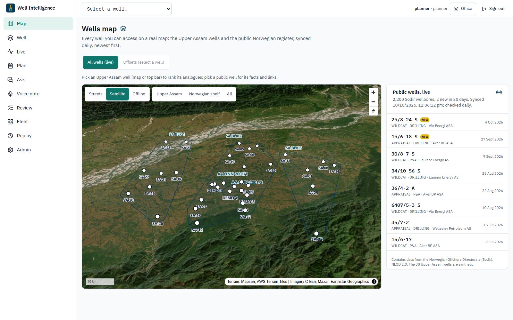
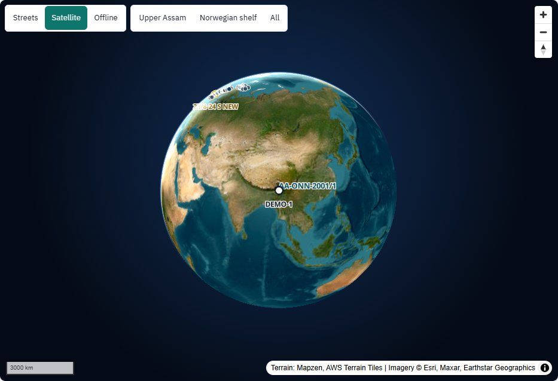
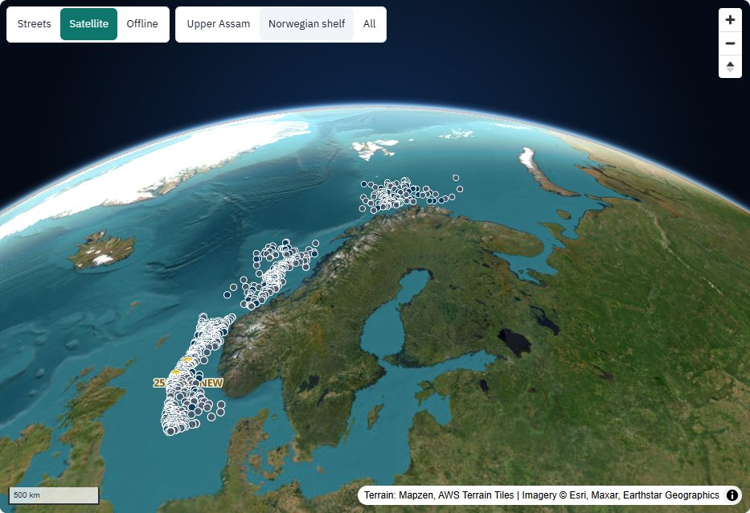
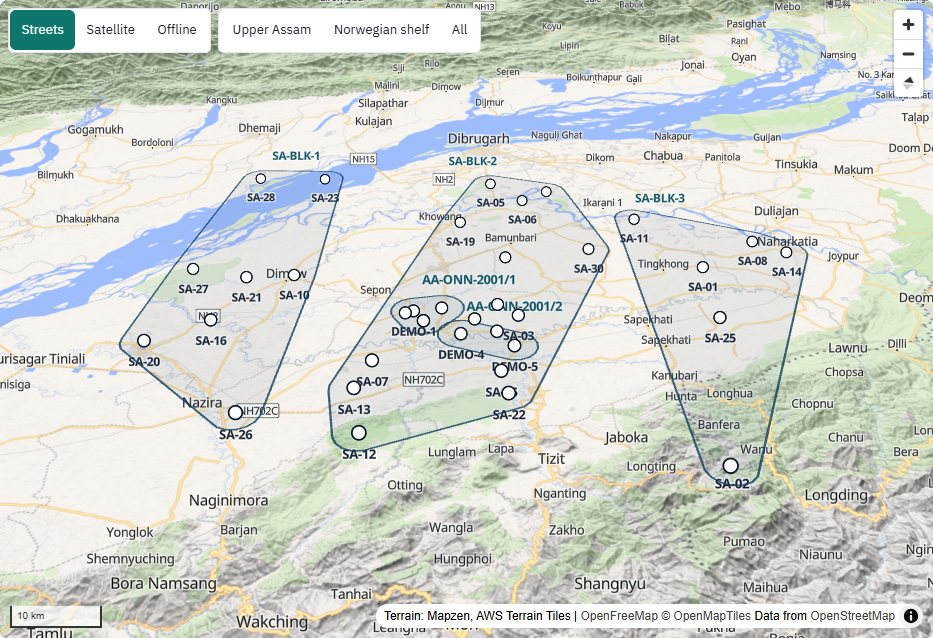
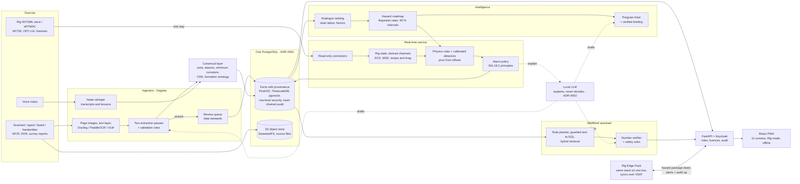

<div align="center">

# eRTMAC-NWIS · Well Intelligence

**Nearby Wells Intelligence System: an AI-powered offset-well knowledge and decision-support
platform for drilling operations**




</div>

Drilling problems such as lost circulation, kicks and stuck pipe repeat from well to well.
What the offset wells learned is buried in decades of typed, scanned, faxed and handwritten
reports, recorded in feet or metres below whichever rig floor drilled them, and in the memory of
the people who were there.

**eRTMAC-NWIS** turns that history into a working tool that runs next to eRTMAC:

1. **Reads** old well completion reports, daily drilling reports and voice notes into facts.
   Each fact keeps a link to the exact box on the page it came from.
2. **Aligns** every depth to one reference (metres MD and TVDSS, minimum-curvature positions).
3. **Finds** the offset wells that really resemble a new well, on a 3D map of the real earth,
   within the radius the planner sets.
4. **Plans** with that history: a formation-by-formation hazard roadmap, and a check of the
   drilling program against what happened in the offsets.
5. **Watches** the live eRTMAC/WITSML feed (read only). Rules raise alerts as the bit approaches
   a formation where offsets had trouble, while the problem starts, and before the next one.
6. **Answers** plain-language questions with citations to the page, voice note or query behind
   every number.

> **The 30 Upper Assam wells in this repository are synthetic.** Real Indian well records are
> confidential, so `data/synthetic_assam` generates the wells, their reports, voice notes and rig
> data, and every synthetic document, answer and screen says so. The software is real. The map's
> live layer is real too: about 2,200 Norwegian exploration wells from the open Sodir register,
> synced daily. See [What is synthetic](#what-is-synthetic).

## Contents

- [For the judges: the 60-second version](#for-the-judges-the-60-second-version)
- [Problem statement SIH26121 → what we built](#problem-statement-sih26121--what-we-built)
- [What it does](#what-it-does)
- [Screenshots](#screenshots)
- [Architecture](#architecture)
- [How it works](#how-it-works)
- [Evaluation](#evaluation)
- [How to run it](#how-to-run-it)
- [The 5-minute demo](#the-5-minute-demo)
- [Security and operations](#security-and-operations)
- [Project structure](#project-structure)
- [Technology](#technology)
- [Documentation](#documentation)
- [Licences](#licences) · [Team](#team) · [What is synthetic](#what-is-synthetic)

## For the judges: the 60-second version

| | |
|---|---|
| **The problem** | Offset-well knowledge sits in PDFs, scans and people's memory, so it reaches the drilling decision late or not at all (Oil India, SIH26121) |
| **What we built** | A standalone platform beside eRTMAC: OCR + AI extraction with provenance, a 3D map of nearby wells, a formation-by-formation hazard roadmap, a drilling-program check, real-time alerts from the live feed, and a cited assistant |
| **Proof, measured** | 30 wells replayed blind through the live path: **89 %** of hazard events alerted at warning or above, **0.09** false alerts per 24 h, a median **19-minute** decision window. The assistant answered **100/100** questions correctly with citations. A number verifier caught **24 of 24** tampered drafts |
| **Safe by design** | Rules decide every alert. The local LLM may only explain one, and every number it writes is checked against the evidence. Kill the LLM and the alerts still fire on time |
| **Ready for OIL** | Runs on OIL's own servers or on one offline rig box. Connects to eRTMAC read-only. Keycloak roles, access limited by licence block and joint venture, a hash-chained audit log, TLS on every hop. Only open-source licences, no fees |
| **Try it** | `.\demo.ps1` (Windows) or `make demo`, then open <https://localhost:5173>. The [five-minute script](docs/demo.md) and the [judges' FAQ](docs/faq.md) |

## Problem statement SIH26121 → what we built

**eRTMAC-NWIS (Nearby Wells Intelligence System): An AI-Powered Offset Well Knowledge and
Decision Support Platform for Drilling Operations.** Oil India Limited · Software · Smart
Automation.

| The statement asks for | How eRTMAC-NWIS delivers it | Where |
|---|---|---|
| AI, NLP and OCR to extract and structure data from historical reports and well documents | Dagster pipeline: text layer first, then Docling, PaddleOCR or a vision model for handwriting. Two independent extraction passes must agree, and validation rules check units, ranges and depth order. Every fact stores its page, box, confidence and extractor version. Anything unsure goes to the **Review console**. Voice notes are transcribed (faster-whisper) into lessons | [Pipelines](docs/pipelines.md), `pipelines/` |
| An interactive map of nearby wells within a user-defined radius | **Wells map**: a 3D globe with terrain relief, satellite or street basemap, and an offline fallback. **Offset map**: surface radius and at-formation radius sliders, 3D trajectories below ground, datum-uncertainty halos, and analogue wells ranked with a bar per factor | [Screens](docs/ui/screens.md), `apps/web/src/pages/Map.tsx` |
| A searchable repository of drilling events, lessons learned, challenges and mitigations | Events (loss, kick, stuck pipe, tight hole, pack-off, torque spike, cement issue, washout, fishing) with NPT, root cause and mitigations, each linked to its source page. **Ask WellMind** searches them in plain language with citations; the **Evidence viewer** opens the page with the value boxed | [Assistant](docs/assistant.md), [Data model](docs/data-model.md) |
| Correlation of geological, drilling and reservoir data across wells by depth and formation | Canonical layer: unit conversions, depth datums, TVDSS, minimum curvature, CRS with datum confidence, formation ontology. The **Correlation panel** puts offsets side by side in TVDSS, flattened on any top, with events, casing shoes, MW and ECD | [Canonical depth](docs/canonical-depth.md) |
| Predictive models for mud losses, stuck pipe, overpressure, torque spikes and cementing issues, from offset-well behaviour | **Hazard roadmap**: per formation and hazard, a similarity-weighted Bayesian probability with a 90 % interval and the number of wells behind it. **Program linter**: casing seats, MW window (losses and kicks), mud type and cement plan, each finding citing offset records. Real-time detectors for losses, kicks (overpressure), stuck pipe, pack-off, washout, and torque and drag against its envelope | [Intelligence](docs/intelligence.md), [Real-time](docs/realtime.md) |
| Real-time alerts and recommendations for drilling engineers | Read-only connectors (WITSML from eRTMAC, WITS0, OPC-UA, historian). Rig-state detection, physics rules plus calibrated detectors, and an alarm policy (deadbands, shelving with a reason, alarm-rate budget). The **lookahead** gives the next hazard band ahead of the bit with its ETA. Alerts cite the offsets' pages and their mitigations | [Real-time](docs/realtime.md), **Live console**, **Fleet board** |
| Proactive alerts when the current well approaches depths or formations where nearby wells had problems | The roadmap's prior for the formation ahead feeds the live detectors, and the lookahead counts down to the band. Both appear on the Live console and the Fleet board | [Real-time](docs/realtime.md) |
| A user-friendly dashboard for field and office staff | Eleven screens. An Office theme and a high-contrast Rig theme with 48 px touch targets. An installable PWA with offline hazard packages and offline voice notes. Each role sees the actions its job needs | [UI](docs/ui.md), [User guide](docs/guide.md) |
| A standalone platform beside eRTMAC, acting as institutional memory | Own database (PostgreSQL + PostGIS + TimescaleDB + pgvector). Reads eRTMAC one way and never writes to rig systems. Runs at headquarters or as the offline **Rig Edge Pack** | [Architecture](docs/architecture.md), [Rig Edge Pack](docs/operations/edge.md) |

Every data source the statement lists has a home: WCRs and DDRs (ingestion), drilling and mud
logging databases and eRTMAC streams (real-time connectors, CSV/historian import), reservoir and
geological data (formation tops, ontology), trajectory and survey data (minimum curvature),
casing, cementing and mud programs (casing, cement and mud tables, program linter), and event
records including mud losses, kicks, stuck pipe, fishing and NPT (event table).

## What it does

| For | Screen | What you get |
|---|---|---|
| Everyone | **Wells map** (3D earth) | The real earth as a 3D globe with terrain relief and atmosphere (Satellite / Streets, offline fallback), with the 30 Upper Assam wells and about 2,200 real Norwegian wells synced daily from the Sodir FactPages; newly spudded wells flagged NEW, each with its facts, FactPage and press release; new completion reports downloaded and extracted automatically |
| Planner | **Offset Map** | Wells on the map with 3-D trajectories, two radii (at surface and at the target formation), datum-uncertainty halos, evidence density and fault blocks; analogue wells ranked with a bar per factor (distance at formation, fault block, top-depth difference, design, mud, vintage, data quality) |
| Planner | **Correlation Panel** | The well and its offsets in TVDSS, flattened on any formation top: tops, losses / kicks / stuck pipe with their source page, casing shoes, mud weight and ECD, the new well's projected hazard bands and bit |
| Planner | **Hazard Roadmap** | Probability, 90 % interval and evidence count of each hazard in each formation ahead, with the next hazard in gold and an ETA from the live rate of penetration |
| Planner | **Program Linter** | Upload a drilling program (CSV/JSON): formation-by-formation pass/fail on casing seats, mud-weight window, mud type and cement, each finding citing the offset records; a briefing PDF whose every number is verified |
| Wellsite engineer | **Live Console** (Rig mode) | Alert card (tier, hazard, formation, probability, why, source pages), flow in/out, pit volume, torque, hookload against its torque-and-drag envelope, standpipe pressure, the MW/ECD window from offset kicks and losses with live ECD, rig-state timeline; acknowledge, shelve with a reason; greys out within 10 s when data goes stale |
| Everyone | **Evidence Viewer** | The source PDF page with the cited value boxed, everything extracted from that page, and how each printed value became the stored one (`printed "3,665 ft" → 1,117.1 m`); voice notes play from the cited second |
| Everyone | **Ask WellMind** | Streamed answers in plain language with citation chips, the evidence and query behind them, spoken questions, suggested follow-ups, lists of wells as table and map |
| Data steward | **Review Console** | What the extractor was not sure of, most valuable first; keyboard J/K/A/R/C; the page with the box; conflicts between passes highlighted; every decision audited |
| Superintendent | **Fleet Board** | Every rig: next hazard and ETA, alert load, data freshness; shift digest |
| Everyone | **Replay Studio** | Any held-out well replayed at 60–600×: the risk line crossing the thresholds, alerts, the recorded event, measured lead time and decision window |
| Wellsite engineer | **Voice Note** (phone, offline) | Record a lesson, tag well and formation, queued offline, uploaded when there is signal, *pending expert confirmation* until a person approves it |
| Admin | **Admin** | Record counts, detector bank, LLM configuration, feeds, audit chain status |

Every screen has loading, empty, error and stale (offline cache) states, works with keyboard and
screen reader, and has an Office theme and a high-contrast Rig theme with 48 px touch targets. The
web app is an installable PWA: a well's hazard package can be saved for offline use.

## Screenshots

The 3D map views are from the running stack; the other screens are generated by Playwright from
data captured from the real API (`make screenshots`).

| | |
|---|---|
|  **Wells map**: the real earth, opening on the globe and flying to the wells |  **Live public wells**: 2,200 Sodir wellbores, newest flagged, synced daily |
|  **3D terrain**: Upper Assam and the Naga Hills, streets basemap |  **Offset Map**: dual radius, trajectories, analogues with per-factor bars |
|  **Correlation Panel**: flattened on a top, events with their pages, projected bands and bit |  **Hazard Roadmap**: probability, interval, evidence, ETA |
|  **Live Console** in Rig mode: alert card, channels, T&D envelope, MW/ECD window |  **Evidence Viewer**: the page, the box, the extracted fields |
|  **Program Linter**: findings by formation with the offsets cited |  **Ask WellMind**: cited answer, evidence, wells as table and map |
|  **Replay Studio**: held-out well, thresholds, measured results |  **Fleet Board**: rigs most urgent first, shift digest |
|  **Review Console**: value-sorted queue, conflicts |  **Voice Note** on a phone: recorded offline, uploaded when there is signal |

All screens, with a user guide per role: [docs/ui/screens.md](docs/ui/screens.md).

## Architecture



| Layer | Runs as | Key choices |
|---|---|---|
| Ingestion | Dagster assets, one partition per document / voice note | Text layer first, OCR / VLM only when needed; two passes must agree; validation rules; anything unsure goes to a person ([Pipelines](docs/pipelines.md)) |
| Canonical layer | `packages/core` | Explicit unit definitions, logged conversions; depth datums and TVDSS; minimum curvature; pinned CRS transformations with datum confidence; a formation ontology where only a rule or a person confirms a name match ([Canonical depth](docs/canonical-depth.md)) |
| Storage | PostgreSQL 17 + PostGIS + TimescaleDB + pgvector, SeaweedFS (S3) | One database for relational, spatial, time-series and vector data; every fact carries a source reference to its page and box ([Data model](docs/data-model.md), [ADR-0001](docs/adr/0001-one-postgresql.md)) |
| Intelligence | `apps/api/intelligence` | Analogues by weighted factors; hazard probabilities as similarity-weighted Beta-Binomial posteriors around basin rates, with 90 % intervals; rule-based program lint ([Intelligence](docs/intelligence.md)) |
| Real-time | `apps/api/realtime`, one service per wellbore | Rig-state detection, derived channels, physics rules plus calibrated XGBoost/Isolation Forest detectors, Bayesian fusion with the formation's prior, an alarm policy with deadbands, shelving and an alarm-rate budget ([Real-time](docs/realtime.md)) |
| Assistant | `apps/api/assistant` | Rule planner first, model-written SQL only through a guard and a read-only role, hybrid retrieval, a number verifier and safety rules ([Assistant](docs/assistant.md)) |
| Serving | FastAPI, Keycloak, React + Vite PWA | Roles that separate duties, ABAC by licence block and JV in the database, MapLibre + deck.gl, ECharts, PDF.js ([API](docs/api.md), [UI](docs/ui.md)) |
| Operations | Docker Compose, Caddy, OpenTelemetry, Prometheus, Grafana, pgBackRest | TLS on every hop, no egress, generated secrets, traces across ingestion, alert path and chat, SLO dashboards, backups with a restore drill ([Operations](docs/operations/index.md)) |

## How it works

**1. An old page becomes a fact.** A document is classified, its pages rendered and read (text
layer, Docling, PaddleOCR, or a vision model for handwriting). Two independent passes extract
each field into a schema; validation rules check units, ranges and depth order. Values the passes
agree on and the rules accept are stored with their page, box, confidence and the extractor
version; anything else goes to a data steward with the box highlighted. Corrections keep the
original value.

**2. Every depth on one reference.** A top printed as `9,851 ft` below the rotary table on a 1988
scan and one printed in metres below ground level on a 2010 report both end up in metres MD and
TVDSS, positioned in 3-D by minimum curvature, with every conversion logged. Offset events are
placed by their relative position inside the formation, so they project correctly onto a well
where the formation is deeper or thicker.

**3. Offsets become a plan.** For a new well and a target formation, candidate offsets within a
surface radius and an at-formation radius are scored on distance at the formation, fault block,
top-depth difference, well design, mud system, vintage and data quality. Their losses, kicks and
stuck pipe become a probability per formation with a 90 % interval and the number of wells behind
it. The linter checks a drilling program against that roadmap and the offsets' shoe tests, kick
and loss mud weights.

**4. Rules raise alerts while drilling.** The real-time service reads WITSML (or WITS0, OPC-UA, a
historian) one way, detects the rig state, derives ECD, MSE and the torque-and-drag hookload, and
evaluates physics rules and calibrated detectors. The likelihood is combined with the
formation's prior from the offsets; an alarm policy turns the posterior into advisory, warning
or critical alerts with deadbands, re-arm, shelving with a reason and an alarm-rate budget. The
alert is stored and delivered first; only then may the LLM write an explanation, verified
against the alert's evidence. Stale data is never shown as live.

**5. Questions get cited answers.** WellMind recognises wells, formations and hazards, plans
queries over read-only views (or lets the model write SQL, through a guard), retrieves passages
and voice-note spans, and drafts an answer. Every number must match the cited evidence or the
answer is regenerated, written by rules, or refused. Questions about well control, live
operations, writes or other licences are refused before anything runs.

**6. On the rig, with no link.** The Rig Edge Pack runs the same stack on one box with a cached
hazard package, local detectors and a small local model; when the VSAT link returns it uploads
alerts, acknowledgements, voice notes and its audit trail, and fetches a fresh package
([Rig Edge Pack](docs/operations/edge.md), [ADR-0004](docs/adr/0004-rig-sync-through-the-api.md)).

## Evaluation

Measured with `make evaluation` on the synthetic data ([Evaluation](docs/evaluation.md),
[HTML report](docs/eval-report/report.html)). Alerts: each of the 30 wells replayed blind through
the live path, with priors and offsets from the other 29 wells only.

| Measure | Result |
|---|---|
| Hazard events alerted (warning or above) | **89 %** of 47 recorded events (98 % at advisory or above) |
| Median lead time | **−0.7 min**: alerts come as the problem starts, not before (0 of 46 before onset) |
| Median decision window (first alert to the event's end) | **19.0 min** |
| False alerts | **0.09 per 24 operating hours** (2 in 561 h) |
| Probability quality | Brier score 0.00040, **skill 0.92** over always predicting the base rate |
| Extraction, typed reports | precision **1.000**, recall **1.000** |
| Extraction, scanned reports | precision **0.966**, recall **0.850** |
| Extraction, faxed reports | precision 0.405, recall **0.043** — goes to people |
| Extraction, handwritten notes | precision 0.722, recall **0.368** — goes to people |
| Assistant, 100 questions (rules) | **100 %** correct, **100 %** cited |
| Verifier, one number changed in 30 % of drafts | caught **24 of 24**, rejected 0 of 86 correct drafts |

**Read these as an upper bound:** the wells, events and rig data are generated by the same
physics the detectors were built on. Earlier warning comes from the plan (roadmap and lookahead),
not from the detectors. Faxes and handwriting are why the review queue exists.

## How to run it

Everything runs in Docker on one laptop; no GPU, cloud account or real well data needed. Tested
end to end on Windows 11 with Docker Desktop (WSL2): `.\demo.ps1`, then the demo checked in a real
browser session through Keycloak and TLS (`tests/e2e/stack.spec.ts`).

### 1. Prerequisites (once)

| | |
|---|---|
| Hardware | 16 GB RAM, 4+ cores, 30 GB free disk |
| Docker | Docker Desktop with the WSL2 backend (Windows) or Docker Engine + Compose v2 (Linux, macOS). On Windows, WSL must be installed first: admin PowerShell `wsl --install --no-distribution`, reboot, then start Docker Desktop. Step-by-step: [docs/setup-windows.md](docs/setup-windows.md) |
| Python | 3.10 or newer on the PATH (it only writes `.env`) |
| Shell | `make` (Linux, macOS, WSL, Git Bash with make) — or PowerShell on Windows, which uses `demo.ps1` |
| Network | For the first run only: about 15 GB of container images and a 1 GB model. Nothing else is downloaded; no well data |

### 2. Start everything

```bash
git clone https://github.com/mak3012/SIH_2026.git
cd SIH_2026
make demo
```

On Windows (PowerShell, from the repository folder):

```powershell
Set-ExecutionPolicy -Scope Process Bypass
.\demo.ps1
```

The first run takes 45–90 minutes (image builds, model, synthetic data, detector training);
later runs take two or three minutes and work offline. It:

1. writes `.env` with random passwords and the laptop settings (small local model, timeouts);
2. builds and starts 13 services over TLS and waits until every one is healthy;
3. copies the stack's certificate authority to `.certs/ca.crt`;
4. pulls the local LLM, generates the 30 synthetic wells with their PDFs and voice notes, loads
   the facts and the search index, trains the detectors (once);
5. replays held-out well SA-06 into its Barail loss and opens its Live Console.

### 3. Open it

Trust the certificate once (then restart the browser):

```powershell
.\demo.ps1 trust     # Windows asks you to confirm: Yes
```

macOS: open `.certs/ca.crt` in Keychain Access, set *Always Trust*. Linux: import it in the
browser's certificate settings.

| What | Address | Sign in |
|---|---|---|
| Web app | <https://localhost:5173> | `planner` / `planner-dev-password` |
| API (OpenAPI) | <https://localhost:5173/api/docs> | – |
| Grafana | <https://localhost:3000> | `admin` / `GRAFANA_ADMIN_PASSWORD` in `.env` |
| Keycloak admin | <https://localhost:8444/auth/admin> | `admin` / `KEYCLOAK_ADMIN_PASSWORD` in `.env` |
| Dagster | <http://localhost:3001> | – |

Users of the web app, one per role, password `<user>-dev-password`: `planner`, `engineer`
(wellsite engineer), `superintendent`, `steward` (data steward), `admin`, `partner` (a JV
partner's planner who sees one licence block). Or click **Sign up** to create your own account
(a read-only viewer until an administrator gives it a role). `make urls` prints all of this
again. Using every screen, roles and sign-in problems: **[docs/guide.md](docs/guide.md)**.

### 4. Present it

Follow [docs/demo.md](docs/demo.md): five minutes, six steps, what to click and what to say.
Before the judges arrive, check the whole demo against the running stack:

```bash
cd tests/e2e && STACK=1 PW_CHANNEL=msedge npx playwright test stack.spec.ts
```

### 5. Stop it

```bash
make demo-down
```

`docker compose down -v` also deletes the data (the next `make demo` regenerates it).

### When something goes wrong

| Symptom | Fix |
|---|---|
| Docker Desktop "unable to start" / "wsl is not installed" | Install WSL (above), reboot, quit and start Docker Desktop |
| `error getting credentials` | Sign in to Docker Desktop once, or remove `"credsStore": "desktop"` from `%USERPROFILE%\.docker\config.json` |
| `ports are not available ... 5432` | A local service uses the port; change it in `.env` (`POSTGRES_PORT`, `WEB_PORT`, ...) |
| Build errors such as `400 Bad Request` or `HTTP response to HTTPS client` | A flaky network or proxy; rerun. Once built, the demo needs no network |
| Browser certificate warning | `.\demo.ps1 trust` (or trust `.certs/ca.crt`) and restart the browser |
| Cannot reach <https://localhost:5173> after a reboot | Docker Desktop stopped: start it, then `.\demo.ps1` |
| Keycloak asks to update the account, or no **Sign up** link | Old realm in the database: `.\demo.ps1 reset-auth` (`make reset-auth`) |

More: [docs/demo.md → Troubleshooting](docs/demo.md#troubleshooting).

### Developing

```bash
uv sync --all-packages        # Python workspace
npm ci                        # web, design system, browser tests
make test                     # Python unit tests + deployment policy tests
make lint && make typecheck   # ruff, mypy, tsc
make e2e                      # Playwright: every screen's main flow and states (mocked API)
make docs                     # this documentation at http://localhost:8001
```

Every make target, deployment shape (laptop, headquarters, rig box) and runbook:
[Operations](docs/operations/index.md).

## The 5-minute demo

[docs/demo.md](docs/demo.md) is a guided script with timings, what to click, what to say and a
fallback for each step:

1. An old **scanned page** of SA-26 → the extracted fact with its **box highlighted** → the
   **depth fix** (printed in feet below the rig floor, stored in metres MD and TVDSS).
2. **Offset Map** with the dual radius → the **Correlation Panel** flattened on the Tipam.
3. The **Program Linter** catches a **risky mud weight**: ECD in the Barail above where offsets
   lost returns.
4. **Replay** of held-out offset SA-06 drilling into the Barail: **advisory, then escalation**,
   with the offsets' **source pages**; the **decision window measured** (19.0 min).
5. **Ask WellMind**: "What went wrong in the Barail on SA-05, SA-06 and SA-16?" → a **cited
   answer**.
6. **Kill the LLM container** → the **alert still fires**, on time, from rules (G3).

Likely questions — what if the LLM is wrong, how depths are aligned, eRTMAC integration, data
security, cost, rollout plan: [docs/faq.md](docs/faq.md).

## Security and operations

- **Identity:** Keycloak (OIDC, PKCE); roles `planner`, `wellsite_engineer`, `superintendent`,
  `data_steward`, `admin` that separate duties ([ADR-0003](docs/adr/0003-roles-separate-duties.md));
  ABAC by licence block and JV enforced by row-level security in the database.
- **Network:** TLS on every hop that carries data or credentials; internal networks with no route
  out; one ingress proxy; a host firewall script for the networks that need a route.
- **Secrets:** environment only, generated for laptops (`make secrets`), injected from the secret
  store in production; compose refuses to start without them.
- **Audit:** hash-chained, append-only log of sensitive reads, edits, decisions, acknowledgements
  and model versions, anchored outside the database.
- **Observability:** OpenTelemetry traces across ingestion, the alert path and chat; Grafana
  service levels (feed latency p95 < 10 s, alert evaluation < 5 s, LLM latency, verifier rejects,
  queue depth) with alert rules that name their runbook.
- **Resilience:** pgBackRest with WAL archiving and an automated restore drill; runbooks for a
  stale feed, LLM down, database restore and model rollback.
- **Supply chain:** licence policy and SBOMs in CI.

Threat model (data exfiltration, prompt injection through documents, insider edits):
[docs/security.md](docs/security.md).

## Project structure

```text
.
├── apps/
│   ├── api/                  FastAPI service (Python)
│   │   ├── src/api/
│   │   │   ├── intelligence/ analogue ranking, hazard roadmap, program linter, briefings
│   │   │   ├── realtime/     connectors, rig state, detectors, alarm policy, live stream
│   │   │   ├── assistant/    WellMind: planner, guarded SQL, retrieval, number verifier
│   │   │   ├── replay/       held-out-well replay and the evaluation
│   │   │   ├── prompts/      versioned LLM prompts
│   │   │   └── *.py          auth, audit, row-level-security scope, screens, public wells, edge sync
│   │   ├── migrations/       Alembic: schema, RLS, audit chain, TimescaleDB
│   │   └── tests/
│   └── web/                  React 19 + Vite PWA
│       └── src/
│           ├── pages/        Map, Well, Live, Plan, Ask, Voice, Review, Fleet, Replay, Admin
│           └── components/   3D earth and offset map, correlation, hazard strip, evidence viewer, charts
├── packages/
│   ├── core/                 shared Python: units, depths, surveys, CRS, ontology, LLM client
│   └── ui/                   design system: tokens, Tailwind preset, components, Storybook
├── pipelines/                Dagster: OCR, extraction, validation, voice notes, Sodir daily sync
├── data/                     synthetic Upper Assam generator, gold set, public-data downloaders
├── infra/                    TLS, secrets, Caddy, Postgres, Keycloak, Prometheus, Grafana, backups, policy tests
├── tests/e2e/                Playwright: flows, states, screenshots, the demo against the stack
├── docs/                     documentation site (MkDocs), evaluation report, ADRs, runbooks
├── docker-compose.yml        the stack (profiles hq, edge, realtime, tools)
├── docker-compose.dev.yml    laptop overlay (local ports, model downloads)
├── demo.ps1 · Makefile       one-command demo and every operational target
└── .env.example              settings template; `make secrets` writes .env with generated secrets
```

## Technology

**Backend:** Python 3.12, FastAPI, psycopg 3, Alembic, Dagster, scikit-learn, XGBoost,
faster-whisper, Docling, PaddleOCR, pint, pyproj, ReportLab, OpenTelemetry.
**Data:** PostgreSQL 17, PostGIS, TimescaleDB, pgvector, SeaweedFS (S3).
**Web:** React 19, TypeScript, Vite, Tailwind, Radix, MapLibre GL (globe, terrain), deck.gl, ECharts, three.js,
PDF.js, Workbox (PWA).
**AI (local):** Ollama or llama.cpp (Qwen2.5), BGE-M3 embeddings — optional; everything works in
rules mode.
**Platform:** Docker Compose, Keycloak, Caddy, Prometheus, Grafana, Tempo, Loki, pgBackRest,
GitHub Actions, Playwright, MkDocs Material.

## Documentation

| Topic | Page |
|---|---|
| Overview and architecture | [docs/index.md](docs/index.md), [docs/architecture.md](docs/architecture.md) |
| Demo script and FAQ | [docs/demo.md](docs/demo.md), [docs/faq.md](docs/faq.md) |
| Data, data model, canonical depth | [docs/data.md](docs/data.md), [docs/data-model.md](docs/data-model.md), [docs/canonical-depth.md](docs/canonical-depth.md) |
| Pipelines, intelligence, real-time, assistant | [docs/pipelines.md](docs/pipelines.md), [docs/intelligence.md](docs/intelligence.md), [docs/realtime.md](docs/realtime.md), [docs/assistant.md](docs/assistant.md) |
| API and UI | [docs/api.md](docs/api.md), [docs/ui.md](docs/ui.md), [docs/ui/screens.md](docs/ui/screens.md), [docs/ui/design-system.md](docs/ui/design-system.md) |
| Security, operations, Rig Edge Pack | [docs/security.md](docs/security.md), [docs/operations/index.md](docs/operations/index.md), [docs/operations/edge.md](docs/operations/edge.md) |
| Evaluation | [docs/evaluation.md](docs/evaluation.md) |
| Decisions | [docs/adr/index.md](docs/adr/index.md) |
| Licences, glossary | [docs/licences.md](docs/licences.md), [docs/glossary.md](docs/glossary.md) |

`make docs` serves them as a site at <http://localhost:8001>.

## Licences

Every dependency and service is open source; there are no licence fees. CI enforces a policy:
permissive licences and unmodified weak-copyleft libraries are allowed; GPL, AGPL, SSPL and
source-available licences are not allowed in code we link or ship; unknown licences fail until
checked. Server components under AGPL (Grafana, Loki, Tempo) and GPL (PostGIS) are used
unmodified as separate programs. Model weights carry their own licences (the defaults are
Apache-2.0 or MIT). Full table, policy and SBOMs: [docs/licences.md](docs/licences.md).

The public datasets the downloaders support (Equinor Volve, Utah FORGE, Sodir) keep their own
terms and are not included in this repository.

## Team

[Aditya Gupta](https://github.com/adbravee)
[Ayush Makade](https://github.com/mak3012)
[Srujan Yadav](https://github.com/SrujaN1906)
[Saket Patil](https://github.com/SaketPramodPatil)
[Shloka Karbhajan]()
[Hrutuja Mandlik]()

## What is synthetic

| Synthetic | Real |
|---|---|
| The 30 Upper Assam wells (SA-01 … SA-30): positions, trajectories, formation tops, casing, mud, shoe tests, events and their causes | The software: every pipeline, model, rule, screen and test in this repository |
| Their documents: Well Completion Reports, Daily Drilling Reports, survey reports and field notes, rendered as typed, scanned, faxed and handwritten PDFs with a "SYNTHETIC" watermark | The formation sequence and the hazard types, taken from public descriptions of the Upper Assam basin |
| Voice notes (text-to-speech) and the 50-document gold set with field-level truth | The units, datums and coordinate systems the canonical layer handles |
| Real-time rig data, generated from each well's plan and recorded events by a physics simulator | The WITSML 1.4.1.1 protocol path the replay runs through, the same as for a live rig |
| The demo wells DEMO-1 … DEMO-5 and the 100-question assistant set | Support for real public data (Volve, Utah FORGE, Sodir), not bundled |
| | The live public wells on the map (Sodir FactPages, open data NLOD 2.0), synced daily, not bundled |

Synthetic documents are marked on every page; synthetic records are flagged in the database,
labelled in every answer ("These records are SYNTHETIC test data") and on every evaluation
screen. The replay never resets a well that has a non-synthetic source. No real Indian well
record is in this repository.
