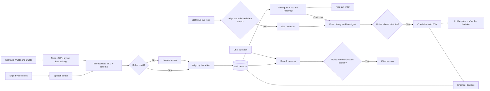

# WellMind: Every Well Remembers

**AI offset well intelligence that warns the rig before the bit meets trouble.**

WellMind (NWIS, Nearby Wells Intelligence System) is a decision-support platform built for Oil India Limited. It reads decades of scanned drilling reports and experts' voice notes, aligns every past well by formation, and runs alongside eRTMAC to warn drilling teams before they reach a formation where offset wells had problems. Every warning comes with the report page it is based on.

| | |
| --- | --- |
| Problem Statement | SIH26121: eRTMAC NWIS, an AI-powered offset well knowledge and decision support platform for drilling operations |
| Organisation | Oil India Limited |
| Theme | Smart Automation |
| Team | Team HackOff |
| Status | In development for Smart India Hackathon 2026 |

---

## Table of contents

- [The problem](#the-problem)
- [Our solution](#our-solution)
- [How it works](#how-it-works)
- [Showstoppers](#showstoppers)
- [Safeguards](#safeguards)
- [Features](#features)
- [Architecture](#architecture)
- [Rules and AI working together](#rules-and-ai-working-together)
- [Tech stack](#tech-stack)
- [Repository structure](#repository-structure)
- [Getting started](#getting-started)
- [Data](#data)
- [Evaluation](#evaluation)
- [Security and deployment](#security-and-deployment)
- [Roadmap](#roadmap)
- [Team](#team)
- [References](#references)
- [License](#license)

---

## The problem

eRTMAC gives Oil India reliable real-time data for the well being drilled. It does not show what happened in earlier wells drilled through the same formations.

- **Knowledge is locked away.** Decades of Well Completion Reports (WCRs) and Daily Drilling Reports (DDRs) exist as scanned and often handwritten PDFs. Much practical know-how was never written down and leaves with retiring engineers.
- **Searching takes hours.** Finding comparable wells and their problems means reading reports by hand, which rarely happens under operational pressure.
- **Risks repeat.** Mud losses, stuck pipe, kicks, torque spikes and cementing problems recur in formations where offset wells already met them, causing avoidable non-productive time (NPT).
- **Depth comparisons mislead.** Reports mix measured and vertical depth, rig elevations, feet and metres, and old map datums. Comparing wells by raw depth places known risks at the wrong depth.

## Our solution

WellMind turns Oil India's drilling history into a formation-aligned memory and uses it at every stage of a well.

- It **reads** scanned reports, handwriting and expert voice notes, and checks every extracted fact.
- It **aligns** every well by formation, so wells are compared by the rock they cut, not by raw depth.
- It **plans** by ranking true analogue wells, building a hazard roadmap and checking the drilling program before spud.
- It **warns** during drilling by combining offset history with live eRTMAC data, with the source page attached.
- It **answers** engineers' questions through a chat assistant, with every number checked against its source.
- It **learns** from every alert outcome, crew debrief and voice note, so each well improves the next.

> **Example (illustrative).** An offset DDR records "partial losses about 40 bbl/hr at 2,410 m". WellMind places this 12% below the top of the Barail formation. Three of seven analogue wells lost mud there (prior risk 0.41). Live data shows flow-out down 6% with ECD near the fracture gradient. The combined risk rises to 0.74, crossing the Warning threshold. The rig sees *"Mud losses likely at Barail top, ETA 6.5 h"* with DDR page 14 attached.

## How it works



1. **Remember.** Documents are classified and read. An LLM extracts events, depths, mud weights, casing and formation tops into fixed schemas. Rules check units, ranges and depth order. Low-confidence facts go to a review queue. Every fact keeps a link to its page and region, or audio timestamp.
2. **Plan.** Analogue wells are ranked by distance at the target formation, geology, well design and data quality. A hazard roadmap gives the risk of each problem per formation, with uncertainty and the number of wells behind it.
3. **Drill.** Live data passes through a rig-state gate, then detectors turn it into evidence. History and live evidence are combined with Bayes' rule. Rules decide Advisory, Warning or Critical.
4. **Learn.** Outcomes, feedback and expert voice notes are added back into memory. Every finished well becomes an offset for the next one.

## Showstoppers

| # | Showstopper | What it does |
| --- | --- | --- |
| S1 | Formation alignment | Stores every depth as MD, TVD, TVDSS and position within the formation, so wells are matched by rock, not raw depth |
| S2 | Page-cited evidence | Every alert and answer links to the exact report page or voice-note moment behind it |
| S3 | History and live fusion | Offset history sets the odds of a hazard; live rig data confirms or dismisses it |
| S4 | Hazard roadmap with ETA | Shows each formation's risk ahead and how many hours until the bit reaches it |
| S5 | Drilling program linter | Checks planned casing seats, mud weights and cement plans against every offset well before spud |
| S6 | Living memory | Grows with every new well, crew debrief and expert voice note |

## Safeguards

| # | Safeguard | Why it matters |
| --- | --- | --- |
| G1 | Rig-state gate and stale-data guard | No alerts while tripping or during connections; stale data shows as stale, never as safe |
| G2 | Replay proof | Past wells are replayed as if live to measure warning lead time and false alarms |
| G3 | The LLM never decides an alert | Rules and models decide; the LLM only explains. If it is down, alerts still fire |
| G4 | Sovereign, offline-capable deployment | Runs on Oil India's servers with no internet egress; rigs keep working when the link drops |

## Features

- **Offset well map** with a user-defined radius at the surface and at the target formation, and 3D trajectories
- **Correlation panel** showing offset wells side by side, aligned on formation tops, with events, casing and mud data
- **Hazard roadmap and lookahead** with probability, uncertainty and ETA for each formation ahead
- **Live alert console** for the rig, with evidence, rig-state timeline and the safe mud-weight window
- **Ask WellMind chat** that answers drilling questions from the records, with citations
- **Expert voice notes** recorded on a phone or rig tablet in English, Hindi or Assamese
- **Program linter and pre-spud briefing PDF**
- **Review console** for low-confidence extractions
- **Fleet board and shift digest** for superintendents
- **Replay studio** to play past wells at high speed and measure lead time

## Architecture

WellMind has four zones and three main flows.

| Zone | Responsibility |
| --- | --- |
| Ingestion plane (batch) | Reads scans, handwriting and voice notes; extracts, validates and canonicalises facts |
| Data plane | One PostgreSQL database for wells, trajectories, events, live channels, document text and provenance |
| Intelligence and serving plane (real-time) | Analogue engine, hazard engine and linter, detectors, alert manager, chat assistant, replay harness |
| OT boundary | Read-only, one-way access to eRTMAC; nothing in eRTMAC changes |

| Flow | Path |
| --- | --- |
| 1. Ingestion | Scan or voice note → extracted fact → validated, aligned memory |
| 2. Live alert | eRTMAC → rig-state gate → detectors → fusion → rule-based tier → rig screen |
| 3. Chat | Question → evidence search → LLM draft → number check → cited answer |

**How one alert is decided**

1. **Offset prior.** Weighted analogue wells give the chance of a hazard in the formation ahead (Beta-Binomial).
2. **Live evidence.** With the rig-state gate open, detectors turn live signals into a likelihood ratio.
3. **Fusion.** Prior and evidence are combined with Bayes' rule into one risk score.
4. **Rules.** The score is checked against tier thresholds, with deduplication and hysteresis.
5. **Alert.** The warning reaches the rig with ETA and source page.
6. **Explanation.** Only after the decision, the LLM writes a plain-language explanation.

## Rules and AI working together

Rules keep the final say on anything safety-relevant. The LLM handles what rules cannot.

| Where | Rules decide | LLM adds |
| --- | --- | --- |
| Extraction | Units, ranges, depth order | Reads free text and handwriting |
| Voice notes | Schema check and expert sign-off | Turns speech into structured lessons |
| Depth and names | Depth maths, datum conversion | Matches messy formation and well names |
| Program lint | Hard limits against offsets | Finds lessons in narratives, drafts the briefing |
| Alerts | The alert tier, with the models | Explains why, in plain words |
| Chat | Every number checked against its page | Understands the question, drafts the answer |

## Tech stack

| Layer | Technologies |
| --- | --- |
| Frontend | React, TypeScript, Vite, Tailwind CSS, shadcn/ui, MapLibre GL, deck.gl, Apache ECharts, PDF.js, PWA |
| API and security | FastAPI (REST and WebSocket), Pydantic, Keycloak (OIDC), role and block-level access |
| Data | PostgreSQL 16 with PostGIS, TimescaleDB and pgvector; MinIO for documents |
| Documents and speech | Docling, PaddleOCR, Qwen2.5-VL, TrOCR, Whisper (faster-whisper) |
| AI and models | vLLM (Ollama for development), XGBoost, scikit-learn, stumpy, bge embeddings and reranker |
| Domain maths | pint (units), pyproj (coordinates), minimum-curvature survey calculation |
| Pipelines and MLOps | Dagster, MLflow |
| Live data | WITSML/ETP, WITS0, OPC-UA and database adapters, WITSML replay simulator |
| Operations | Docker Compose, k3s, Prometheus, Grafana, Loki, OpenTelemetry |

All components use open licences. See `docs/licences.md`.

## Repository structure

```text
wellmind/
├── apps/
│   ├── api/            # FastAPI services: intelligence, realtime, assistant, replay
│   └── web/            # React app: office view and offline-capable rig view
├── pipelines/          # Dagster assets: ingestion, extraction, validation, voice notes
├── packages/
│   ├── core/           # Shared Python: schemas, units, depth and datum maths
│   └── ui/             # Design tokens and shared React components
├── data/               # Download scripts and synthetic data generator (raw data git-ignored)
├── infra/              # Docker Compose, Keycloak realm, Grafana dashboards
├── docs/               # MkDocs site: architecture, ADRs, runbooks, evaluation
├── tests/              # Unit, integration and Playwright end-to-end tests
├── CLAUDE.md           # Project context and design rules for contributors
└── Makefile
```

## Getting started

> The commands below describe the intended developer workflow. Some targets are still being built.

**Requirements:** Docker and Docker Compose, Make, 16 GB RAM (a GPU is optional and only speeds up batch reading and chat).

```bash
git clone https://github.com/<your-org>/wellmind.git
cd wellmind
cp .env.example .env

make up       # start database, API, web app, pipelines and monitoring
make seed     # download public data and generate the synthetic Upper Assam set
make demo     # replay a held-out well and open the live console
```

| Service | Default URL |
| --- | --- |
| Web app | http://localhost:5173 |
| API docs | http://localhost:8000/docs |
| Dagster | http://localhost:3000 |
| Grafana | http://localhost:3001 |

Other useful targets: `make test`, `make lint`, `make docs`, `make replay WELL=<id> SPEED=300`.

## Data

| Source | Use |
| --- | --- |
| [Equinor Volve](https://www.equinor.com/energy/volve-data-sharing) | Real-time drilling data and daily drilling reports for detectors and replay |
| [Sodir FactPages](https://factpages.sodir.no) | Well locations, formation tops and scanned completion reports for OCR testing |
| [Utah FORGE](https://utahforge.com) | High-frequency drilling data |
| Synthetic Upper Assam set | Team-generated wells and degraded scanned reports with known ground truth |

Synthetic data is clearly labelled as synthetic everywhere it appears. Check each dataset's licence before use; terms are recorded in `docs/licences.md`.

## Evaluation

| Measure | Method |
| --- | --- |
| Extraction accuracy | Field-level precision and recall on a 50-document gold set |
| Warning lead time | Hours between first warning and the DDR-recorded event, on held-out wells |
| False alerts | Alerts per 24 drilling hours not followed by an event |
| Calibration | Brier score and calibration curve of the risk score |
| Chat accuracy | Correct, cited answers on a fixed question set; verifier reject rate |

Models are trained and tested well by well (leave-one-well-out and group K-fold), never by mixing rows from the same well. Figures shown in demos are illustrative until produced by the replay harness.

## Security and deployment

- Runs fully on-premise in Oil India's data centre, with no internet egress at runtime
- Read-only, one-way connection to eRTMAC
- Keycloak sign-in linked to the corporate directory, with role and block-level access
- Encryption in transit and at rest, and a hash-chained audit log
- The live alert path runs on CPUs; one GPU node handles batch reading and chat
- A small edge unit at each rig keeps alerts working offline
- Advisory only: well control and kick alarms remain with the mud logger and eRTMAC

## Roadmap

- [x] Problem analysis, architecture and design
- [ ] Data pipeline and canonical depth model
- [ ] Analogue engine, hazard roadmap and program linter
- [ ] Live path with WITSML simulator, detectors and alert manager
- [ ] Chat assistant and expert voice notes
- [ ] Replay harness and evaluation report
- [ ] Web app: map, correlation panel, live console, chat, replay studio
- [ ] SIH 2026 finale demo
- [ ] Shadow pilot on two to three rigs
- [ ] Advisory rollout and fleet deployment

## Team

**Team HackOff**

- Ayush Sudhakar Makade
- Saket Pramod Patil
- Srujan Sharad Yadav
- [Aditya Anup Gupta](https://github.com/adbravee)
- Hrutuja Dnyaneshwar Mandlik
- Shloka Anand Karbhajan

## References

- Energistics WITSML and ETP standards for wellsite data exchange
- ANSI/ISA-18.2, management of alarm systems
- Johancsik, Friesen and Dawson (1984), torque and drag in directional wells
- IADC activity codes for daily drilling reports
- [Oil India Limited](https://www.oil-india.com), [DGH](https://www.dghindia.gov.in), [OISD](https://www.oisd.gov.in)

## License

To be decided by the team. All third-party components are used under open-source licences listed in `docs/licences.md`.
