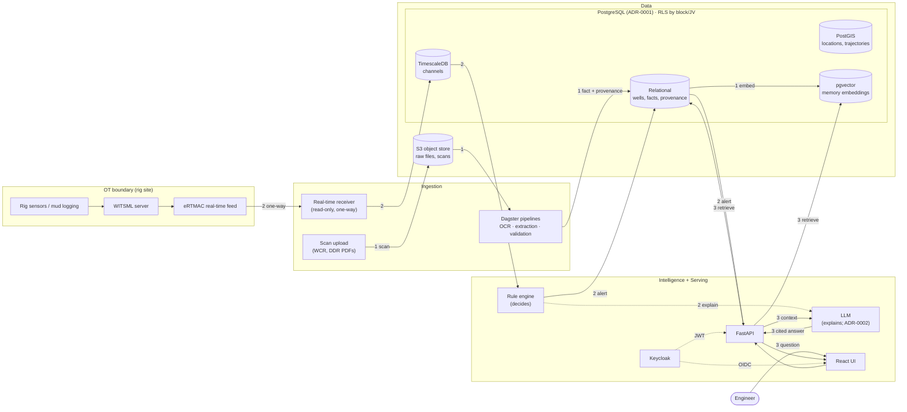

# Architecture

Four zones. Data moves one way across the OT boundary: out of the rig, never back in.

## Flows

**1. Scan → fact → memory.** A scanned report lands in the S3 object store. A Dagster pipeline extracts
values (depths, casing points, mud weights, NPT events), validates them against depth maths and
units in `packages/core`, and writes each value as a fact that points back to the page and region
it came from. Facts are embedded into pgvector so they can be recalled later.

**2. eRTMAC → alert.** Real-time channels cross the OT boundary one way (WITSML, WITS0,
OPC-UA or SQL connectors, all read-only) into TimescaleDB. Rig state, derived channels (MSE,
ECD, torque & drag) and calibrated detectors give a likelihood ratio; the hazard roadmap gives
the prior; rules turn the posterior into advisory / warning / critical alerts under an
ISA-18.2-style policy. The alert is stored and pushed to the live view first; only then may the
LLM add an explanation, and it cannot create, suppress or change an alert (ADR-0002).

**3. Question → cited answer.** A question (typed or spoken) is answered from rows of the
read-only `chat.v_*` views (rule-planned or model-written SQL, run as `app_ro` under the
caller's licences) and from passages found by hybrid retrieval (full-text + pgvector). The LLM
drafts only from that evidence; a rule-based verifier checks every number, depth and date
against the evidence each sentence cites, else the answer is regenerated or becomes "not in the
records". Citations point to the document page and bbox, or the voice-note time span. Details:
[Assistant](assistant.md).

Tables, provenance rules and access control: [Data model](data-model.md). Flow 1 in detail
(assets, rules, confidence, voice notes): [Pipelines](pipelines.md). Analogues, hazard roadmap,
lookahead, program linter and verified briefings: [Intelligence](intelligence.md). Flow 2 in
detail (connectors, simulator, detectors, alarm policy, WebSocket): [Real-time](realtime.md).

## Zones

| Zone | Runs | Trust |
|---|---|---|
| OT boundary | Rig systems, WITSML, eRTMAC | Not ours. Read-only, outbound only. |
| Ingestion | Upload endpoint, stream receiver, Dagster | Untrusted input is parsed and validated here. |
| Data | PostgreSQL, S3 object store (SeaweedFS) | Source of truth. |
| Intelligence + Serving | Rules, LLM, API, UI, Keycloak | Every request authenticated; each role may do only its own actions ([ADR-0003](adr/0003-roles-separate-duties.md)). |
| Ingress | Caddy proxy | The only published ports; TLS in and TLS to every upstream. |
| Rig box | The same stack on one machine, offline-first | Syncs with headquarters through the API when the link is up ([ADR-0004](adr/0004-rig-sync-through-the-api.md)). |

Every service sits on internal networks with no route out; TLS on every hop that carries data
or credentials; every sensitive read, edit, acknowledgement and model load in the hash-chained
audit log; traces (OpenTelemetry → Tempo) across ingestion, the alert path and chat, and
service-level metrics in Prometheus and Grafana. Details and the threat model:
[Security](security.md); procedures: [Operations](operations/index.md).
