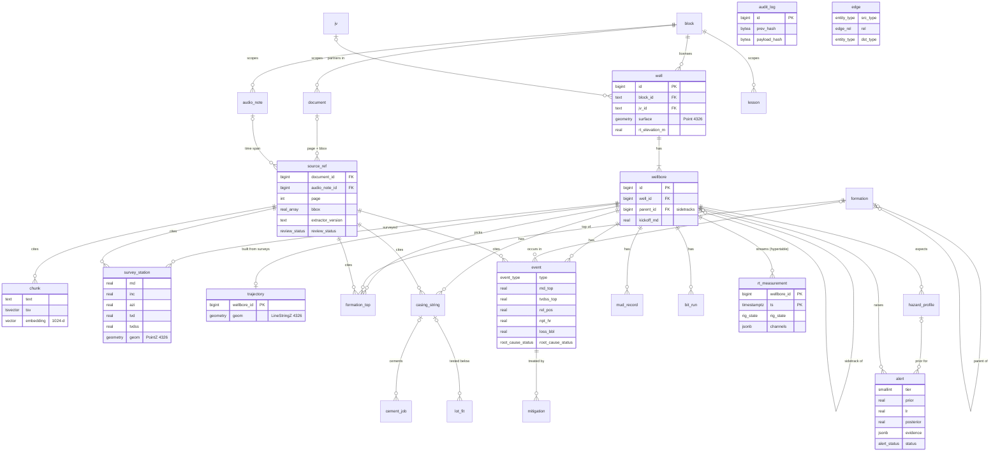

# Data model

One PostgreSQL database ([ADR-0001](adr/0001-one-postgresql.md)). Schema is owned by Alembic
migrations in `apps/api/migrations/versions`, written as plain SQL. There is no ORM model to
drift from them.

| Migration | Adds |
|---|---|
| `0001_provenance` | Extensions, `block`, `jv`, `app_visible()`, `document`, `audio_note`, `source_ref`, `chunk`, `formation` |
| `0002_wells` | `well`, `wellbore`, `survey_station`, `trajectory` (+ refresh triggers), `formation_top` |
| `0003_drilling_facts` | `event`, `mitigation`, `casing_string`, `cement_job`, `mud_record`, `bit_run`, `lot_fit` |
| `0004_realtime_intelligence` | `rt_measurement` (hypertable), `hazard_profile`, `alert`, `lesson`, `edge` |
| `0005_audit_log` | `audit_log`, hash-chain trigger, `audit_verify()` |
| `0006_access_control` | Roles `app_rw`, `app_ro`; grants; row-level security policies |
| `0007_chat_views` | Schema `chat`: `v_wells`, `v_events`, `v_tops`, `v_casing` with column comments |
| `0008_document_origin` | `document.source`, `document.synthetic`, `audio_note.source`, `audio_note.synthetic` |
| `0009_review_queue` | `review_item`, `llm_call`, `event.timeline`, lesson status `pending_confirmation` + `md_top` / `md_base` |
| `0010_canonical` | `basin`, `formation.rank` / `abbreviations` / `expected_tvdss_*`, `wellbore.datum_type` / `datum_elevation_m`, `well.source_crs` / `datum_confidence` / `position_uncertainty_m`, `source_ref.conversions`, `hazard_profile.rel_top` / `rel_base`, `name_match` |
| `0011_intelligence` | `well.fault_block`, `event_documentation`, `offset_selection` + `offset_selection_item`, `drilling_program`, `lint_run`, `briefing` |
| `0012_realtime` | `rt_feed`, `rt_gap`, `alert_shelf`; alert lifecycle columns (formation, rig state, cleared, peak posterior, suppression, detector version, calibration) |
| `0013_assistant` | `assistant_conversation`, `assistant_turn` (private per user under RLS), `chat.v_wells` |
| `0014_voice_capture` | `audio_note.wellbore_id` / `formation_id` / `note` / `uploaded_by` / `client_id` (unique: offline re-uploads are idempotent) for notes captured in the app |
| `0015_audit_status` | `audit_status()` (SECURITY DEFINER: entry count, head id and hash, first broken id) for the app role; index on `audit_log (entity, entity_id)` |
| `0016_edge_sync` | Rig box: `edge_outbox`, `edge_state`, `edge_enable()` (identity sequences to 2^50, outbox triggers on `alert`, `alert_shelf`, `audio_note`). Headquarters: `edge_box` (each box's audit head), `edge_record` (rig id → HQ id). See [Rig Edge Pack](operations/edge.md) |

## Entity-relationship diagram

Key columns only. `cites` edges show the `source_ref_id` every fact table carries (drawn for a
few tables to keep the diagram readable; the rule holds for all of them).



`audit_log` and `edge` stand alone: the audit log names entities in text, and edges have
polymorphic ends.

## Conventions

- Depths in **metres**, measured from RT (see [Glossary](glossary.md)). TVDSS is positive down
  below mean sea level.
- Densities (MW, ECD, EMW) in **specific gravity (sg)**. Volumes in **bbl** where the column name
  says so (`loss_bbl`), otherwise m³.
- Times are `timestamptz`, stored UTC.
- Surface and subsurface positions are `geometry(..., 4326)` (WGS 84 lon/lat) with Z in metres,
  positive up (Z = −TVDSS). Distances cast to `geography` so they come out in metres.
- Primary keys are `bigint` identities; `block.id` and `jv.id` are the licence codes.

## Provenance

### `source_ref`

Where a value came from. Exactly one of `document_id` / `audio_note_id` is set.

| Column | Meaning |
|---|---|
| `document_id`, `page`, `bbox` | Document page and region. `bbox` = `[x0, y0, x1, y1]`, page-relative 0–1, origin top-left. |
| `audio_note_id`, `t_start`, `t_end` | Audio span in seconds from the start of the note. |
| `extractor_version` | Pipeline + model version that produced the value, e.g. `ocr-table@1.4.0`. |
| `confidence` | Extractor confidence, 0–1. |
| `review_status` | `pending` → `accepted` / `corrected` / `rejected`. |
| `reviewer`, `reviewed_at` | Set if and only if the status is not `pending`. |
| `conversions` | Every unit conversion applied to the values behind this reference: field, value and unit in and out, factor, method, library version. |

### `document`

A source file. The bytes live in the S3 object store at `uri`; `sha256` is unique so a re-uploaded file is
recognised. `type` (WCR, DDR, mud log, …), `vintage` (report date), `classification`
(`public` … `confidential`), and the `block_id` / `jv_id` that control who may read it.

### `audio_note`

A voice note: `duration_s`, `speaker`, `lang` (BCP-47), and the same `block_id` / `jv_id` scope.

`document` and `audio_note` also record `source` (`upload`, `sodir`, `volve`, `forge`,
`synthetic_assam`, …) and `synthetic`. **An answer that cites a row with `synthetic = true` must
say the source is synthetic.**

### `chunk`

A retrieval passage. `text`, a generated `tsv` (English full-text), and `embedding`
`vector(1024)` with an HNSW cosine index. A chunk cites through its `source_ref_id`, so a passage
and a fact extracted from the same page resolve to the same kind of citation.

### Rules

1. **Every fact has a `source_ref_id`**, `NOT NULL`. A value without a source is not stored.
2. **One source per row.** If two reports disagree, store two rows, each with its own
   `source_ref`. Resolution happens in review, not by overwriting.
3. **Corrections keep history.** A reviewer correcting a value sets `review_status = corrected`
   on the original `source_ref` and inserts the corrected fact with a new `source_ref` whose
   `extractor_version` is `human`.
4. **Deletes are blocked** from `document` / `audio_note` while any `source_ref` points at them
   (`ON DELETE RESTRICT`).
5. **Real-time measurements** are provenance by construction (wellbore + timestamp + stream) and
   carry no `source_ref`.
6. **Citations** in answers resolve to `source_ref` → document page + bbox, or audio + time span.

## Reference data

### `block`, `jv`

Access scopes. `block.id` is the licence block code; `jv.id` the joint-venture code.

### `basin`, `formation`

`basin` is a tree (`parent_id`): basin → sub-basin, e.g. Assam-Arakan → Upper Assam Shelf.

`formation`: stratigraphic unit in a `basin`, with `rank` (group / formation / member),
`parent_id` (group → formation → member), `synonyms[]` (spellings seen in reports, GIN-indexed),
`abbreviations[]` (BRL, TPM) and a typical TVDSS range (`expected_tvdss_top` / `_base`) used to
check that a matched name is at a plausible depth. Shared across blocks and not access-controlled.
How printed names are matched to it: [Canonical depth](canonical-depth.md#formation-ontology-and-name-matching).

### `name_match`

Every formation or well name resolution: `printed`, the candidate (`formation_id` or `well_id`),
`proposed_by` (rule / llm / human), `status` (confirmed / needs_human / rejected),
`confirmed_by` (`rule` or a person; required when confirmed), `checks` (edit distance, ontology,
depth plausibility) and the document or audio note it came from. An LLM can propose; only a rule
or a person confirms.

## Wells and geometry

### `well`

Surface location (`surface`, Point, WGS 84), depth datum (`rt_elevation_m`: RT above MSL), licence
scope (`block_id`, `jv_id`), `field`, `basin`, `uwi`, `spud_date`, `status`. `surface::geography`
is GiST-indexed for radius searches in metres. Where the position came from: `source_crs` (the
report's CRS), `datum_confidence` (known / inferred / unknown) and `position_uncertainty_m` (see
[Canonical depth](canonical-depth.md#coordinates-datums-and-confidence)).

### `wellbore`

One hole path. The original hole has no parent. A sidetrack sets `parent_id` and `kickoff_md` (MD
on the parent where it leaves); the database enforces that both are set or neither.
`datum_type` (KB / RT / DF / GL / MSL) and `datum_elevation_m` are this wellbore's depth
reference (TVDSS = TVD − `datum_elevation_m`); set together or not at all.

### `survey_station`

`md`, `inc`, `azi` as surveyed; `tvd`, `tvdss` and `geom` (PointZ, Z = −TVDSS) computed at
ingestion by minimum curvature (`core.depth.minimum_curvature`) from the well's surface location and
RT elevation. `tvd ≤ md` is checked.

### `trajectory`

One `LineStringZ` per wellbore, kept current by statement-level triggers on `survey_station`.
Where surveys from several sources overlap, the newest non-rejected `source_ref` wins at each MD.
It is a table, not a `MATERIALIZED VIEW`, because materialized views cannot have row-level
security. After changing a survey's review status, call `trajectory_rebuild(ARRAY[wellbore_id])`.

### `formation_top`

A pick: the MD (and TVD, TVDSS) where a wellbore enters a `formation`.

## Drilling facts

Every table here carries `wellbore_id` and a `NOT NULL source_ref_id`.

### `event`

A drilling problem. `type` is one of `loss`, `kick`, `stuck_pipe`, `tight_hole`, `pack_off`,
`torque_spike`, `cement_issue`, `washout`, `fishing`, `other`.

| Column | Meaning |
|---|---|
| `md_top`, `md_base`, `tvdss_top`, `tvdss_base` | Depth interval (a point event has base = top or NULL) |
| `formation_id`, `rel_pos` | Formation the event sits in, and where within it: 0 = top, 1 = base |
| `t_start`, `t_end`, `npt_hr` | When, and the rig time lost |
| `severity` | 1 (minor) … 5 (well-control event) |
| `loss_bbl` | Mud lost; only allowed on `loss` events |
| `mw`, `ecd` | Mud weight and ECD at the time, sg |
| `narrative` | Text as reported |
| `root_cause`, `root_cause_status` | `recorded` (stated in the report), `inferred` (by a person or model), `unknown` (then `root_cause` must be NULL) |
| `outcome` | How it ended (cured, cased off, sidetracked, …) |

### `mitigation`

Actions taken against one event: `action`, `t_applied`, `effective` (NULL = not known), `notes`.

### `casing_string`

`kind` (conductor … liner), `od_in`, `hole_size_in`, `weight_ppf`, `grade`, `md_top`, `md_shoe`,
`tvdss_shoe`, `set_date`. Pipe sizes stay in inches, as every report writes them.

### `cement_job`

Per stage: interval, `slurry_density_sg`, `volume_m3`, `returns` (full / partial / none), `toc_md`
(top of cement), optional link to the `casing_string` it cemented.

### `mud_record`

A mud check: `ts`, `md`, `mud_type` (wbm / obm / sbm), `mw` (sg), `pv_cp`, `yp_lbf100ft2`,
`funnel_vis_s`.

### `bit_run`

`run_no`, `bit_size_in`, `bit_type`, `iadc_code`, `md_in`, `md_out`, `hours`, `rop_avg_m_hr`,
`dull_grade` (IADC).

### `lot_fit`

`test_type` (`lot` / `fit`), `md`, `tvd`, `emw` (sg), and the shoe (`casing_string_id`) it tested.
EMW is the ECD ceiling for the next hole section, which is what real-time rules compare against.

## Real-time and intelligence

### `rt_measurement`

TimescaleDB hypertable, 1-day chunks, primary key `(wellbore_id, ts)`. `bit_md`, `hole_md`,
`rig_state` (drilling_rotary, drilling_slide, reaming, circulating, tripping_in/out, connection,
static, unknown), then typed **hot columns** the rules read every second: `rop_m_hr`, `wob_kn`,
`rpm`, `torque_knm`, `spp_bar`, `flow_in_lpm`, `hookload_kn`, `mw_in`, `ecd`. Every other
channel goes into `channels` jsonb under its canonical name (`flow_out`, `pit_vol`, `block_pos`),
together with the derived channels (`mse`, `dxc`, `delta_flow`, `hookload_pred`, `hookload_dev`,
`stick_s`, ...). Writes are idempotent per channel ([Real-time](realtime.md#idempotent-writes)).
Promote a channel to a column when a rule starts reading it.

### `hazard_profile`

Expected hazards along a planned or active wellbore: per `hazard` (an `event_type`) and interval,
a `prior` probability built from offset wells. Intervals are stored formation-relatively
(`formation_id`, `rel_top`, `rel_base`) with the absolute depths as a cache, so a new top pick
re-projects them (`updated_at`; see [Canonical depth](canonical-depth.md#live-top-re-anchoring)). `basis` lists the offset events used;
`model_version` says how.

### `alert`

Raised by a rule (`rule_id`, `rule_version`), never by the LLM ([ADR-0002](adr/0002-rules-decide-llm-explains.md)).

| Column | Meaning |
|---|---|
| `tier` | 1 advisory, 2 warning, 3 critical |
| `prior`, `lr`, `posterior` | Prior from the hazard profile, likelihood ratio from live evidence, posterior. The database checks `posterior = prior·lr / (prior·lr + 1 − prior)`. |
| `evidence` | Channel values, thresholds and fact ids the rule used |
| `status`, `ack_by`, `ack_at` | `open` → `acknowledged` → `resolved`, or `dismissed` |
| `feedback`, `feedback_note` | Engineer's verdict: true / false positive, unsure. Feeds evaluation. |
| `llm_explanation`, `llm_model` | Advisory text and the model that wrote it; set together or not at all |

Real-time lifecycle columns (migration 0012): `formation`, `rig_state` at raise; `last_seen_at`,
`peak_posterior`, `updates` (escalations, reopenings); `cleared_at` (returned to normal);
`suppressed` (`shelved` / `budget`: recorded, not delivered; never on a critical alert) with
`shelf_id`; `detector_version`, `calibrated`; `explanation_status` (none, pending, done, failed,
timeout, disabled), `explanation_error`, `llm_citations`. `raised_at` is the data time of the
sample that raised it.

### `lesson`

A lesson learned: `title`, `body`, `recommendation`, optional `hazard`, `formation_id` and
depth range (`md_top`, `md_base`), `status` draft or pending_confirmation (extracted from a voice
note by the pipeline) → approved (needs `approved_by`) → retired. Scoped by `block_id` / `jv_id`.
Linked to its source events by `edge` rows with `rel = learned_from`.

### `edge`

Typed relation `src rel dst` between any two entities, e.g. `event caused_by formation`,
`event mitigated_by mitigation`, `lesson learned_from event`, `event similar_to event`. Ends are
polymorphic (`entity_type` + id) and have no foreign key.

## Intelligence

Tables behind [Intelligence](intelligence.md) (migration `0011_intelligence`). All are under
row-level security through their wellbore; `app_rw` may read and insert.

| Table | Holds |
|---|---|
| `event_documentation` | Depth intervals (MD) of a wellbore whose drilling problems were documented: a WCR problems table covers the whole hole, a DDR the interval drilled that day (`kind` wcr_problems / ddr / manual), with a `source_ref`. An event type absent inside a documented interval is **none**; outside, **unknown**. Written by the pipelines. |
| `offset_selection` | One analogue choice for an active wellbore: target formation, `params` (radii, weights, scales, pinned, excluded), who, when |
| `offset_selection_item` | Every candidate shown in that choice: raw `features`, `factors` (score and contribution per factor), total `score`, `rank`, `pinned` / `excluded` / `included`. Training rows for learning-to-rank. |
| `drilling_program` | An uploaded program (sections, mud weights, cement plan) as JSON |
| `lint_run` | Findings, evidence and the roadmap they used, with the ruleset version |
| `briefing` | Briefing text, evidence, verification report, `status` (verified / fallback), model, PDF bytes |

`well.fault_block` is the structural block from interpretation (NULL = not interpreted); the
analogue score treats NULL as unknown, not as "different".

## Assistant

Migration `0013_assistant`, behind [Assistant](assistant.md).

| Table / column | Holds |
|---|---|
| `assistant_conversation` | One conversation: `user_name`, `title`, created / updated |
| `assistant_turn` | One question and answer: `input_mode` (text / voice), `intent`, `status` (answered / not_in_records / refused / error), `answer`, `entities` (context for follow-ups), `citations`, `evidence` (the "show evidence" payload), `verification` (verifier report and queries), `followups`, `model`, `latency_ms` |
| `chunk.embedding_model` | Which model produced `embedding`; vector search compares only one model's vectors |

Both assistant tables are private to their user: RLS compares `user_name` with the session
setting `app.user`, which the API sets from the token in the same transaction as
`api.db.scoped`. `chat.v_wells` gains `source_ref_id` so well-header facts can be cited.

## Real-time

Tables behind [Real-time](realtime.md) (migration `0012_realtime`), under row-level security
through their wellbore.

| Table | Holds |
|---|---|
| `rt_feed` | One connector per wellbore (`witsml`, `etp`, `wits0`, `opcua`, `sql`, `simulator`): `state` live / stale / disconnected / stopped, `last_sample_ts` (data time), `last_rx_at` (wall clock), `config` (never secrets) |
| `rt_gap` | `stale` (wall-clock silence, detectors paused) and `data_gap` (jump in sample time) intervals |
| `alert_shelf` | A shelved hazard: `reason` (at least 5 characters), `shelved_by`, `expires_at` at most 12 h after `shelved_at` (checked by the database), unshelving |

`llm_call.alert_id` links explainer calls to their alert. `app_rw` may read feeds and gaps and
read, insert and update shelves; samples, feeds and alerts are written by the real-time service
as the owner.

## Extraction review and model calls

### `review_item`

What the pipelines would not store on their own ([Pipelines](pipelines.md)): a value whose
confidence is below the threshold, a value failing a rule, a table row that cannot be stored
(a required field not accepted, unknown well or formation), a document-level problem
(unrecognised type, missing required field), or a voice-note lesson failing its rules.

| Column | Meaning |
|---|---|
| `document_id` / `audio_note_id` | Exactly one is set |
| `kind` | `field`, `row`, `lesson` or `document` |
| `field`, `value`, `printed` | Field name (`tops[2].md`), canonical value (jsonb), text as read |
| `page`, `bbox` / `t_start`, `t_end` | Where on the page, or when in the recording |
| `confidence`, `components` | `min(ocr, consistency, rules)` and the three parts |
| `rule_failures`, `reason` | Why it is here |
| `extractor_version` | Pipeline, engines, passes and prompt versions that produced it |
| `status`, `resolved_by`, `resolved_at` | `open` → `accepted` / `corrected` / `rejected` |

A rerun with the same extractor version adds nothing (unique on source + field + version).
Row-level security follows the document or audio note; `app_rw` may read and resolve items.

### `llm_call`

Every LLM/VLM attempt: backend, model, model version, prompt id and sha256, temperature, input
hash, attempt number, whether the stricter schema was used, request, raw output, parse result,
error, latency, and the document or audio note. Pipeline-internal: no grants to app roles.

### Additions to facts

- `event.timeline` (jsonb): for events stitched from several DDR rows or days, every row with
  its date, from, to, hours, text, document, page and bbox.
- `lesson.status` adds `pending_confirmation` (machine-extracted, awaiting an expert; needs no
  `approved_by`), and `lesson.md_top` / `md_base` give the depth range in metres.

## Audit

### `audit_log`

Append-only record of who did what: `ts`, `actor`, `action`, `entity`, `entity_id`, `payload`.
Each row is hash-chained to the one before it:

```
payload_hash = sha256(prev_hash || audit_canon(row))
prev_hash    = payload_hash of the previous row (32 zero bytes for the first)
```

`audit_canon` joins `id`, `ts` (UTC, microseconds), `actor`, `action`, `entity`, `entity_id` and
`payload::text` with a unit-separator byte, so the hash does not depend on session time zone or
formatting settings.

- A `BEFORE INSERT` trigger assigns `id`, `prev_hash` and `payload_hash`. Writers cannot choose
  them. An advisory lock serialises inserts so `id` order is chain order.
- `UPDATE`, `DELETE` and `TRUNCATE` raise an error, for every role including the owner.
- `SELECT audit_verify()` walks the chain and returns the `id` of the first row whose `prev_hash`
  or `payload_hash` does not match; `NULL` means intact. An edit, a deleted middle row or a
  re-ordered row all break the chain.
- Deleting the **newest** rows cannot be detected from inside the table. `python -m api.audit
  anchor` (hourly, `make audit-anchor`) writes the head outside the database and
  `python -m api.audit verify` checks every anchored entry is still there with the same hash.
- `audit_status()` gives the app role (which cannot read the table) the count, head and
  verification result, for the admin page.

What is recorded, and why: [Security → Audit](security.md#audit). The API writes entries with
`api.audit.record()` in the same transaction as the action.

## Access control

Attribute-based: a row is visible when its **block** or its **JV** is in the caller's grants.

| Attribute | Session setting | Example |
|---|---|---|
| Blocks the user may read | `app.blocks` | `AA-ONN-2001/1,AA-ONN-2001/2` |
| JVs the user is a partner in | `app.jvs` | `JV-DEMO` |

The API sets both per transaction from the Keycloak token, then switches role
(`api.db.scoped`):

```sql
SET LOCAL ROLE app_rw;
SELECT set_config('app.blocks', 'AA-ONN-2001/1', true), set_config('app.jvs', '', true);
```

Unset or empty settings mean **no rows** (deny by default). `app_visible(block_id, jv_id)` is the
single predicate.

| Scope | Tables | Policy |
|---|---|---|
| Own block/JV | `well`, `document`, `audio_note`, `lesson` | `app_visible(block_id, jv_id)` |
| Via wellbore | `wellbore` (via `well`), `survey_station`, `trajectory`, `formation_top`, `event`, `casing_string`, `cement_job`, `mud_record`, `bit_run`, `lot_fit`, `rt_measurement`, `hazard_profile`, `alert` | `wellbore_id IN (SELECT id FROM wellbore)` |
| Via parent | `mitigation` (event), `source_ref` (document or audio note), `chunk` (source_ref) | parent id visible |
| Not filtered | `block`, `jv`, `formation`, `edge` | Reference data; edges hold ids only |

Policies chain: a fact is visible if its wellbore is, which is visible if its well is. The same
policy is the `WITH CHECK`, so a user cannot insert or move a row into a block they cannot see.

Roles:

| Role | Can | Used by |
|---|---|---|
| table owner (migration user) | Everything; **bypasses RLS** | Migrations, trusted ingestion pipelines |
| `app_rw` | Read/write facts under RLS; `INSERT` only on `audit_log` | API requests |
| `app_ro` | `SELECT` on `chat.*` views only | Chat text-to-SQL |

!!! warning "TimescaleDB caveats"
    RLS on `rt_measurement` applies when it is queried through the hypertable. It is **not**
    applied to chunks queried directly by name, and it is not supported on compressed chunks.
    So: `app_ro` has no access to `rt_measurement` at all, `app_rw` only runs the API's fixed
    queries, and hypertable compression stays off while RLS is on (revisit with ADR-0001).
    See [timescaledb#7830](https://github.com/timescale/timescaledb/issues/7830).

## Chat views

Schema `chat` holds the only relations `app_ro` can read. Each view is owned by `app_rw`, so
base-table RLS filters it with the caller's `app.blocks` / `app.jvs`. Every column has a
`COMMENT` that the text-to-SQL prompt includes, with units and allowed values. Rows whose source
was **rejected** in review are hidden.

| View | One row per | Notable columns |
|---|---|---|
| `chat.v_wells` | well | `surface` (Point), `lon`, `lat`, `rt_elevation_m`, `spud_date`, `td_md`, `source_ref_id` (from 0013) |
| `chat.v_events` | event | `event_type`, depths, `formation`, `rel_pos`, `npt_hr`, `loss_bbl`, `mw`, `ecd`, `mitigations`, `source_document`, `source_page` |
| `chat.v_tops` | formation top | `formation`, `synonyms`, `md`, `tvdss`, `position` (PointZ at the top, from the nearest survey station) |
| `chat.v_casing` | casing string | `kind`, `od_in`, `md_shoe`, `shoe_test`, `shoe_test_emw`, `toc_md` |

Read the comments with:

```sql
SELECT c.relname AS view, a.attname AS column, col_description(c.oid, a.attnum) AS comment
FROM pg_attribute a
JOIN pg_class c ON c.oid = a.attrelid
JOIN pg_namespace n ON n.oid = c.relnamespace
WHERE n.nspname = 'chat' AND a.attnum > 0 AND NOT a.attisdropped
ORDER BY c.relname, a.attnum;
```

## Demo seed

`make seed` runs `python -m api.seed` in the api container (as the table owner). It is
idempotent: a second run prints `already seeded`. All values are invented.

| Item | Seed |
|---|---|
| Basin | Upper Assam |
| Formations | Tipam (top ≈ 1750 m TVDSS), Barail (≈ 2600), Kopili (≈ 3250), with synonyms |
| Blocks | `AA-ONN-2001/1`: DEMO-1, DEMO-2, DEMO-3 · `AA-ONN-2001/2`: DEMO-4, DEMO-5 (DEMO-5 also in `JV-DEMO`) |
| Surveys | DEMO-1 and DEMO-5 vertical; the others build 2–3°/30 m to 30–40° |
| Sidetrack | DEMO-3 sticks pipe in the Kopili and is sidetracked from 2900 m MD as `DEMO-3 ST1` |
| Events | Losses near the Barail top on DEMO-1, -2, -4; stuck pipe on DEMO-3; tight hole and a kick on DEMO-5 |
| Per well | One synthetic WCR `document`, a `source_ref` per fact, 13⅜ in and 9⅝ in casing, cement job, LOT/FIT below the 9⅝ in shoe, a `chunk` per event narrative |

One `audit_log` row records the seed. Distances at the Barail top from DEMO-1: DEMO-3 ≈ 2.8 km,
DEMO-2 ≈ 4.0 km, DEMO-4 ≈ 8.3 km, DEMO-5 ≈ 12.7 km.

## Example queries

These run as `app_ro` against the chat views, so RLS applies. `apps/api/tests/test_seed.py` runs
the same SQL against the seed and checks the answers stated here.

**Offset wells within 5 km of DEMO-1, measured at the Barail top, that lost mud near that top.**
Distance is between the subsurface positions of the Barail top in each wellbore, not between
surface locations.

```sql
WITH ref AS (
    SELECT position FROM chat.v_tops
    WHERE well = 'DEMO-1' AND wellbore = 'DEMO-1' AND formation = 'Barail'
)
SELECT t.well,
       round(ST_Distance(t.position::geography, ref.position::geography)) AS distance_m,
       e.loss_bbl, e.md_top, e.source_document, e.source_page
FROM ref
JOIN chat.v_tops t ON t.formation = 'Barail' AND t.well <> 'DEMO-1'
                  AND ST_DWithin(t.position::geography, ref.position::geography, 5000)
JOIN chat.v_events e ON e.wellbore_id = t.wellbore_id AND e.formation = 'Barail'
WHERE e.event_type = 'loss' AND e.md_top - t.md BETWEEN 0 AND 50
ORDER BY distance_m;
```

Returns DEMO-2 (≈ 4 km, 420 bbl). DEMO-3 is within 5 km but had no losses; DEMO-4 had losses but
is ≈ 8 km away. A user granted only block `AA-ONN-2001/2` gets no rows, because DEMO-1 is
invisible to them.

**Losses by formation.** Barail comes first, with 3 events.

```sql
SELECT formation, count(*) AS events, sum(npt_hr) AS npt_hr, sum(loss_bbl) AS loss_bbl
FROM chat.v_events WHERE event_type = 'loss'
GROUP BY formation ORDER BY loss_bbl DESC;
```

**ECD margin to the shoe test at each loss.** A small or negative margin means the loss was
predictable from data already on file.

```sql
SELECT e.well, e.ecd, c.shoe_test, c.shoe_test_emw,
       round((c.shoe_test_emw - e.ecd)::numeric, 2) AS margin_sg
FROM chat.v_events e
JOIN chat.v_casing c ON c.wellbore_id = e.wellbore_id AND c.kind = 'intermediate'
WHERE e.event_type = 'loss'
ORDER BY margin_sg;
```

**Full-text retrieval with citations.** Runs as `app_rw`: `chunk` is not exposed to text-to-SQL.

```sql
SELECT d.title, r.page, r.bbox, ts_rank(c.tsv, q) AS rank
FROM chunk c
JOIN source_ref r ON r.id = c.source_ref_id
JOIN document d ON d.id = r.document_id,
     websearch_to_tsquery('english', 'lost returns Barail') q
WHERE c.tsv @@ q
ORDER BY rank DESC;
```

**Match a formation by any of its names.**

```sql
SELECT well, md, tvdss FROM chat.v_tops
WHERE formation = 'Barail' OR 'BARAIL' = ANY (synonyms);
```

**Verify the audit chain** (as the owner or an auditor).

```sql
SELECT audit_verify();  -- NULL = intact, else the id of the first broken row
```

## Tests

`apps/api/tests`, run by `make test-db` locally and by CI against `timescale/timescaledb-ha:pg17`.
Without `TEST_DATABASE_URL` they skip.

| File | Checks |
|---|---|
| `test_migrations.py` | Upgrade → downgrade to base → upgrade gives the same schema; every step downgrades; `rt_measurement` is a hypertable; every chat view column has a comment |
| `test_audit.py` | Rows chain; `UPDATE` / `DELETE` refused; an edited row and a deleted row are each caught by `audit_verify()`; `app_rw` can append but not read, and sees `audit_status()`; an anchor catches a deleted tail |
| `test_edge.py` | Hazard package within the wellbore's licences, loaded into an empty rig database (twice, no duplicates); rig rows get rig-range ids and are queued; a batch syncs with shelf → alert mapping, again idempotently; only the sync account may sync; an edited rig audit entry is refused (409); the package endpoint keeps to the account's licences |
| `test_rls.py` | A block-A user sees only block-A wells, wellbores, documents, events and chunks; cross-block insert refused; no attributes → no rows; JV grant works; `app_ro` reads filtered views but not base tables, and cannot write |
| `test_seed.py` | Seed counts, trajectories built by the trigger, and the example queries above return the answers stated |
