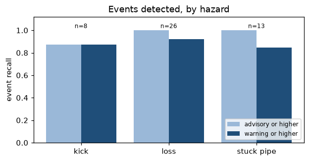
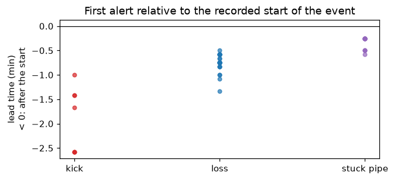
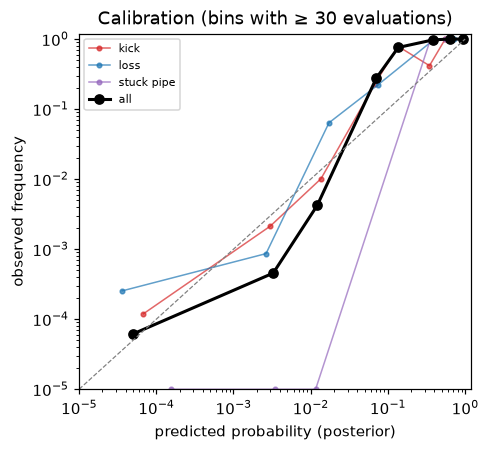

# Evaluation

How we know the system is right:

- **Extraction:** field-level precision, recall and F1 against the gold set (below).
- **Hazard probabilities:** do the roadmap's 90 % intervals contain the true rate? (below)
- **Alerts:** leave-one-well-out replay through the live path: event recall, lead time, false
  alerts per 24 operating hours, Brier score and calibration (below).
- **Answers:** accuracy and citations on the 100-question set, verifier reject rate
  ([Assistant](assistant.md#evaluation)).

Everything here is measured on **synthetic** data (`synthetic_assam`), whose physics and
statistics the methods were designed around: read these numbers as an upper bound, not as field
performance. They are the only numbers the UI and the pitch deck may quote: `metrics.json`
holds them by key, and `python -m api.replay fill <files>` replaces each `[measured:<key>]`
placeholder with its value (bare `[measured]` placeholders are listed, since they do not say
which number they mean).

## Headline numbers

`make evaluation` regenerates this table, the alert section below, and the
[HTML](eval-report/report.html) / [PDF](eval-report/report.pdf) report with charts and a
timeline per well.

<!-- headline:start -->
Generated 2026-10-08 00:52 UTC by `python -m api.replay evaluate` (detectors from the saved run). Full report: [HTML](eval-report/report.html), [PDF](eval-report/report.pdf); numbers: [metrics.json](eval-report/metrics.json); per well: `eval-report/wells.json` and the risk-score timelines the Replay studio plays (`eval-report/timelines/<well>.json`).

| Measure | Value |
|---|---|
| Alert event recall (warning or higher) | **89%** of 47 recorded events (98% advisory or higher) |
| Median lead time (first alert vs the event's recorded start) | **-0.7 min** (0 of 46 detected events warned before they started) |
| Decision window (first alert to the event's recorded end) | **19.0 min** median over 46 detected events |
| False alerts per 24 operating hours | **0.09** (2 in 561 h) |
| Brier score (all hazards, every evaluation) | **0.00040**, skill 0.92 vs always predicting the base rate |
| Extraction, typed documents | precision **1.000**, recall **1.000** |
| Extraction, scanned documents | precision **0.966**, recall **0.850** |
| Extraction, fax documents | precision **0.405**, recall **0.043** |
| Extraction, handwritten documents | precision **0.722**, recall **0.368** |
| Assistant answer accuracy (rules) | **100%** of 100 questions, citations 100%, verifier reject rate 0.0% |
| Assistant with the configured LLM | not measured in this run (`--chat-llm`) |
<!-- headline:end -->

## Extraction

**Gold set:** 50 synthetic documents with field-level truth (`data/raw/synthetic_assam/gold/
gold_set.json`, see [Data](data.md#gold-set)): 14 typed, 16 scanned, 8 faxed, 12 handwritten.
**Run:** `make eval` (= `python -m pipelines.evaluate --write-docs`), which runs the same
`process()` the Dagster assets run, with the engines installed on that machine.

**Scoring** per field, list items pooled (`tops[].md`):

- TP: predicted and equal to the gold value within the precision reports print at (0.16 m
  for depths, 1e-5° for coordinates, 0.006 otherwise; strings case- and punctuation-insensitive).
- FP: predicted but wrong, or a field the gold set does not have. FN: not predicted, or wrong
  (a wrong value counts as both FP and FN).
- "Readable": documents where at least one engine produced text.

Values are scored on what pass A (the template parser) extracted, before routing: this measures
reading, not acceptance. Routing is checked separately: every field below the threshold must be
in the review queue and every field at or above it accepted.

**Acceptance:** field-level F1 ≥ 0.85 on typed pages (`pipelines/tests/test_gold.py` fails
otherwise, in CI) and zero routing errors.

### Results

<!-- eval:start -->
Gold set: `data/raw/synthetic_assam/gold/gold_set.json` (50 documents). Threshold 0.8. Optional engines in this run: docling yes, paddleocr yes. Generated 2026-10-01 by `python -m pipelines.evaluate`.

### By how the document was produced

| Render | Docs | Readable | Precision | Recall | F1 |
|---|---|---|---|---|---|
| typed | 14 | 14 | 1.000 | 1.000 | **1.000** |
| scanned | 16 | 16 | 0.966 | 0.850 | **0.904** |
| fax | 8 | 4 | 0.405 | 0.043 | **0.078** |
| handwritten | 12 | 12 | 0.722 | 0.368 | **0.488** |

### Per field

Typed counts, then F1 per render (`-`: field not in that stratum or not readable).

| Field | TP | FP | FN | typed F1 | scanned F1 | fax F1 | handwritten F1 |
|---|---|---|---|---|---|---|---|
| `block` | 5 | 0 | 0 | 1.000 | 0.889 | 0.800 | - |
| `casing[].grade` | 15 | 0 | 0 | 1.000 | 0.889 | 0.000 | - |
| `casing[].hole_in` | 15 | 0 | 0 | 1.000 | 1.000 | 0.000 | - |
| `casing[].od_in` | 15 | 0 | 0 | 1.000 | 1.000 | 0.000 | - |
| `casing[].shoe_md` | 15 | 0 | 0 | 1.000 | 0.933 | 0.000 | - |
| `casing[].shoe_tvd` | 15 | 0 | 0 | 1.000 | 0.667 | 0.000 | - |
| `casing[].weight_ppf` | 15 | 0 | 0 | 1.000 | 0.741 | 0.000 | - |
| `completion_date` | 5 | 0 | 0 | 1.000 | 1.000 | 0.800 | - |
| `coordinate_datum` | 5 | 0 | 0 | 1.000 | 0.600 | 0.000 | - |
| `date` | 0 | 0 | 0 | - | - | - | 0.800 |
| `datum_elevation` | 5 | 0 | 0 | 1.000 | 1.000 | 0.000 | - |
| `depth_md` | 7 | 0 | 0 | 1.000 | 1.000 | 0.000 | 0.588 |
| `depth_reference` | 5 | 0 | 0 | 1.000 | 1.000 | 0.800 | - |
| `event_type` | 0 | 0 | 0 | - | - | - | 0.500 |
| `events[].date` | 8 | 0 | 0 | 1.000 | 1.000 | 0.000 | - |
| `events[].formation` | 8 | 0 | 0 | 1.000 | 1.000 | 0.000 | - |
| `events[].md` | 8 | 0 | 0 | 1.000 | 1.000 | 0.000 | - |
| `events[].mw` | 8 | 0 | 0 | 1.000 | 0.909 | 0.000 | - |
| `events[].npt_hr` | 8 | 0 | 0 | 1.000 | 0.833 | 0.000 | - |
| `events[].type` | 8 | 0 | 0 | 1.000 | 1.000 | 0.000 | - |
| `events[].volume_bbl` | 8 | 0 | 0 | 1.000 | 0.667 | 0.000 | - |
| `field` | 5 | 0 | 0 | 1.000 | 1.000 | 0.000 | - |
| `formation` | 0 | 0 | 0 | - | - | - | 0.667 |
| `ground_elevation` | 5 | 0 | 0 | 1.000 | 1.000 | 0.000 | - |
| `hole_size` | 7 | 0 | 0 | 1.000 | 1.000 | 0.000 | - |
| `latitude` | 5 | 0 | 0 | 1.000 | 1.000 | 0.000 | - |
| `longitude` | 5 | 0 | 0 | 1.000 | 1.000 | 0.000 | - |
| `loss_bbl` | 0 | 0 | 0 | - | - | - | 0.500 |
| `lot_fit[].casing` | 10 | 0 | 0 | 1.000 | 0.889 | 0.000 | - |
| `lot_fit[].emw` | 10 | 0 | 0 | 1.000 | 0.889 | 0.000 | - |
| `lot_fit[].md` | 10 | 0 | 0 | 1.000 | 0.889 | 0.000 | - |
| `lot_fit[].test_type` | 10 | 0 | 0 | 1.000 | 0.889 | 0.500 | - |
| `mitigation` | 0 | 0 | 0 | - | - | - | 0.000 |
| `mud_weight` | 7 | 0 | 0 | 1.000 | 0.857 | 0.000 | 0.667 |
| `npt_hours` | 7 | 0 | 0 | 1.000 | 1.000 | 0.000 | 0.400 |
| `pit_gain_bbl` | 0 | 0 | 0 | - | - | - | 0.000 |
| `progress` | 7 | 0 | 0 | 1.000 | 1.000 | 0.000 | - |
| `remarks[]` | 6 | 0 | 0 | 1.000 | 0.800 | 0.000 | - |
| `report_date` | 7 | 0 | 0 | 1.000 | 0.933 | 0.000 | - |
| `report_no` | 7 | 0 | 0 | 1.000 | 1.000 | 0.571 | - |
| `spud_date` | 5 | 0 | 0 | 1.000 | 1.000 | 0.800 | - |
| `survey[].azi` | 250 | 0 | 0 | 1.000 | 0.907 | - | - |
| `survey[].east` | 250 | 0 | 0 | 1.000 | 0.868 | - | - |
| `survey[].inc` | 250 | 0 | 0 | 1.000 | 0.915 | - | - |
| `survey[].md` | 250 | 0 | 0 | 1.000 | 0.903 | - | - |
| `survey[].north` | 250 | 0 | 0 | 1.000 | 0.904 | - | - |
| `survey[].tvd` | 250 | 0 | 0 | 1.000 | 0.864 | - | - |
| `td_md` | 5 | 0 | 0 | 1.000 | 1.000 | 0.000 | - |
| `td_tvd` | 5 | 0 | 0 | 1.000 | 0.800 | 0.000 | - |
| `time_breakdown[].code` | 29 | 0 | 0 | 1.000 | 1.000 | 0.000 | - |
| `time_breakdown[].description` | 29 | 0 | 0 | 1.000 | 0.677 | 0.000 | - |
| `time_breakdown[].from` | 29 | 0 | 0 | 1.000 | 1.000 | 0.000 | - |
| `time_breakdown[].hours` | 29 | 0 | 0 | 1.000 | 0.968 | 0.000 | - |
| `time_breakdown[].to` | 29 | 0 | 0 | 1.000 | 1.000 | 0.000 | - |
| `tops[].formation` | 30 | 0 | 0 | 1.000 | 1.000 | 0.000 | - |
| `tops[].md` | 30 | 0 | 0 | 1.000 | 1.000 | 0.000 | - |
| `tops[].tvd` | 30 | 0 | 0 | 1.000 | 1.000 | 0.000 | - |
| `tops[].tvdss` | 30 | 0 | 0 | 1.000 | 1.000 | 0.000 | - |
| `total_hours` | 7 | 0 | 0 | 1.000 | 1.000 | 0.000 | - |
| `trajectory_type` | 5 | 0 | 0 | 1.000 | 0.889 | 0.500 | - |
| `well_name` | 14 | 0 | 0 | 1.000 | 0.875 | 0.364 | 0.333 |

### Routing, IADC mapping, stitching

- Fields routed: 0 accepted, 4539 to review. Fields whose routing disagrees with their confidence: **0**.
- IADC code from operation text vs printed mnemonic: 57/60 (95.0%).
- DDR stitching (events whose report days all have a typed DDR): 21/21 truth events found with exact start time, 21 with exact NPT hours, 15 of them spanning more than one report; 29 events stitched.
<!-- eval:end -->

### How to read these numbers

- **Typed pages are synthetic and template-like.** The parser reads labels and table headers,
  not coordinates, but it was written against the same family of layouts the generator draws.
  1.000 here means "no bugs on this layout family", not "1.000 on real WCRs and DDRs". Real
  documents (Sodir, FORGE, Volve downloads) have no field-level truth yet; labelling 20–30 of
  them is the next evaluation step.
- **Scanned and faxed pages** measure OCR + deskew + parsing on degraded images. Fax loses
  decimal points and thin strokes by design, so low recall there is expected and those values
  must go through review.
- **Handwritten notes** are meant for the VLM path. Without `LLM_BACKEND` configured they are
  read by Docling/PaddleOCR, which are not handwriting models; the number shown is that fallback.
- **Nothing is auto-accepted without a second pass** (consistency 0.5 < threshold 0.8). With an
  LLM configured, agreeing values are accepted; that run's accepted precision is the number to
  watch before trusting auto-acceptance.
- IADC mapping is checked against the mnemonic printed on the synthetic DDRs; stitching against
  the generator's event timeline (exact start time and NPT hours).

## Hazard roadmap

**Question:** when offsets are drawn with known hazard probabilities, do the roadmap's 90 %
intervals contain them about 90 % of the time?

**Data:** 300 synthetic wells from `synthetic_assam` (5 seeds × 60 wells). Each well has each
hazard in each formation with the probability set in `stratigraphy.toml` (e.g. Barail losses
0.35, Girujan stuck pipe 0.25), so the truth is known. Every well's WCR documents its problems,
all weights are 1 (pure Beta-Binomial with a Jeffreys prior).

**Result** (`apps/api/tests/test_intelligence_roadmap.py`, run in CI):

| | |
|---|---|
| Intervals containing the seeded probability | **73 of 80 (91 %)**, nominal 90 % |
| Intervals missing it by more than a 99.9 % interval | 0 |
| Zero-probability cells (e.g. kicks in the Girujan) | posterior mean < 3 %, 0 events |
| Formations below every TD (Langpar) | `no_evidence` in all wells: no number claimed |

Seed 1 in detail (60 wells):

| Formation · hazard | Seeded p | Posterior mean | 90 % interval |
|---|---|---|---|
| Barail · loss | 0.35 | 0.40 | 0.30–0.51 |
| Girujan · stuck pipe | 0.25 | 0.22 | 0.14–0.31 |
| Kopili · stuck pipe | 0.20 | 0.24 | 0.15–0.33 |
| Kopili · kick | 0.10 | 0.12 | 0.06–0.20 |
| Sylhet · loss | 0.25 | 0.32 | 0.23–0.42 |
| Dhekiajuli · stuck pipe | 0.03 | 0.09 | 0.04–0.16 (a miss) |

A separate simulation checks the interval itself: over 400 random 30-well sets at p = 0.05, 0.2
and 0.5, coverage stays within 84–96 %.

**Limits.** This checks the statistics, not the geology: the synthetic probabilities are
placeholders, events are independent between wells, and every offset is equally similar. Real
offsets are correlated (same field, same crew) and their similarity weights are themselves
estimates; with real data, compare roadmap probabilities with outcomes of newly drilled wells.

## Alerts: leave-one-well-out replay

**Question:** for a well the system has never seen, does the live path raise the right alert,
when, and how often does it raise one for nothing?

**Method** (`apps/api/src/api/replay`, `make evaluation`; one well at watchable speed:
`make replay WELL=SA-06 SPEED=300`):

1. **Priors from the other wells only.** Analogues are ranked around the held-out well
   (`an.candidates` never includes the well itself) at its middle formation, within 50 km at
   surface and 20 km at the formation; the hazard roadmap is built from those offsets, and the
   basin rates that centre its prior exclude the held-out well. Its own events never enter a
   number.
2. **Its real-time data.** `synthetic.plan_from_db` turns the well's survey, casing and
   DDR-recorded events (loss, kick, stuck pipe at their depths) into rig data; each recorded
   event happens when the bit reaches its depth. Depth windows from 120 m above to 40 m below
   each event are replayed (merged when they overlap; 250 m mid-well when a well has no event),
   separated by a two-hour feed gap.
3. **Through the live path.** The WITSML 1.4.1.1 simulator serves the data; the WITSML poller
   reads it; the real-time service stores it, detects rig state, derives channels, runs the
   detectors (trained on separate synthetic wells, never on these) and the alarm policy, and
   raises alerts, exactly as for a live rig. `evaluate` runs unpaced and in parallel;
   `make replay` runs at the given speed so the live view shows it.
4. **Recorded and scored.** Every evaluation's risk (posterior per hazard), prior, rig state and
   depth, and every delivered alert.

**Definitions.**

| Measure | Definition |
|---|---|
| Event | A drilling problem in the well's DDR / WCR record. Its **start** is the replay time its episode begins: what the DDR time log records as the start of the problem |
| Detected | A delivered alert of the same hazard raised from 6 h before the start until 30 min after the event ends; reported at advisory or higher and at warning or higher |
| Lead time | Event start minus the first matching alert. Positive: warned before the event began. Negative: detected after it began (the detectors see an event as it develops; only the prior can warn earlier) |
| Decision window | The event's recorded end minus the first matching alert: how long the crew had, after the first alert, while the problem was still developing |
| False alert | A delivered alert (raised or reopened) that matches no event of its hazard; per 24 operating hours (every rig state except static and unknown) |
| Brier score | Mean of (posterior − label)² over every 5-second evaluation and hazard, label 1 inside an event. Skill = 1 − Brier / Brier of always predicting the base rate |
| Calibration | Evaluations binned by posterior: mean posterior against the observed share inside an event |

<!-- replay:start -->
Leave-one-well-out over **30 synthetic wells**, 570 h of replayed rig data (561 operating hours); samples lost between simulator and service: 0.

### Per hazard

| Hazard | Events | Detected (advisory+) | Detected (warning+) | Median lead (min) | Before start | False alerts | per 24 h |
|---|---|---|---|---|---|---|---|
| kick | 8 | 7 (88%) | 7 (88%) | -1.7 | 0 | 2 | 0.09 |
| loss | 26 | 26 (100%) | 24 (92%) | -0.8 | 0 | 0 | 0.00 |
| stuck pipe | 13 | 13 (100%) | 11 (85%) | -0.2 | 0 | 0 | 0.00 |

### Calibration

| Hazard | Evaluations | Base rate | Brier | Brier (base rate only) | Skill |
|---|---|---|---|---|---|
| kick | 409,490 | 0.0035 | 0.00074 | 0.00344 | 0.78 |
| loss | 409,490 | 0.0193 | 0.00111 | 0.01891 | 0.94 |
| pack off | 409,490 | 0.0000 | 0.00000 | 0.00000 | – |
| stuck pipe | 409,490 | 0.0063 | 0.00054 | 0.00630 | 0.91 |
| tight hole | 409,490 | 0.0000 | 0.00000 | 0.00000 | – |
| washout | 409,490 | 0.0000 | 0.00000 | 0.00000 | – |
| all | 2,456,940 | 0.0048 | 0.00040 | 0.00482 | 0.92 |

### Per well

| Well | Offsets (leave-one-out) | Events | Detected (warning+) | Lead (min) | Decision window (min) | False alerts | Operating h |
|---|---|---|---|---|---|---|---|
| SA-01 | SA-11, SA-30, SA-14, SA-08 … | loss | 1/1 | -0.8 | 19.0 | 0 | 10.2 |
| SA-02 | SA-24, SA-15, SA-29, SA-01 … | none | 0/0 | – | – | 0 | 14.5 |
| SA-03 | SA-04, SA-24, SA-22, SA-29 … | loss, loss | 2/2 | -0.8, -0.6 | 19.0, 31.0 | 0 | 20.8 |
| SA-04 | SA-22, SA-03, SA-29, SA-18 … | kick, loss | 2/2 | -2.6, -0.6 | 12.3, 31.0 | 0 | 20.5 |
| SA-05 | SA-19, SA-06, SA-09, SA-18 | loss | 1/1 | -0.8 | 19.0 | 0 | 10.2 |
| SA-06 | SA-19, SA-18, SA-05, SA-11 … | loss | 1/1 | -0.8 | 19.0 | 0 | 10.2 |
| SA-07 | SA-13, SA-17, SA-26, SA-22 … | none | 0/0 | – | – | 0 | 14.5 |
| SA-08 | SA-14, SA-25, SA-11, SA-01 | stuck pipe, loss, stuck pipe | 3/3 | -0.2, -0.6, -0.2 | 12.0, 31.0, 26.4 | 0 | 32.3 |
| SA-09 | SA-19, SA-05, SA-06, SA-30 … | stuck pipe | 1/1 | -0.2 | 12.0 | 0 | 10.3 |
| SA-10 | SA-21, SA-20, SA-16, SA-17 … | loss, stuck pipe | 2/2 | -0.8, -0.2 | 19.0, 21.0 | 0 | 20.5 |
| SA-11 | SA-30, SA-18, SA-01, SA-06 … | loss | 1/1 | -0.8 | 18.9 | 0 | 10.2 |
| SA-12 | SA-22, SA-13, SA-15, SA-07 … | none | 0/0 | – | – | 0 | 14.5 |
| SA-13 | SA-07, SA-12, SA-29, SA-15 … | kick | 1/1 | -2.6 | 12.3 | 0 | 9.9 |
| SA-14 | SA-08, SA-25, SA-11, SA-01 | stuck pipe, loss, loss | 2/3 | -0.6, -0.6, -1.0 | 11.7, 31.0, 23.6 | 0 | 32.1 |
| SA-15 | SA-29, SA-24, SA-12, SA-22 … | none | 0/0 | – | – | 0 | 14.5 |
| SA-16 | SA-27, SA-20, SA-10, SA-21 … | loss | 1/1 | -0.8 | 19.0 | 0 | 10.2 |
| SA-17 | SA-18, SA-21, SA-07, SA-10 … | kick, loss, stuck pipe | 2/3 | -0.7, -0.2 | 30.9, 26.4 | 0 | 31.9 |
| SA-18 | SA-17, SA-11, SA-30, SA-06 … | none | 0/0 | – | – | 0 | 14.5 |
| SA-19 | SA-06, SA-24, SA-09, SA-05 … | stuck pipe | 1/1 | -0.5 | 11.8 | 0 | 10.3 |
| SA-20 | SA-10, SA-21, SA-26, SA-16 … | loss, kick | 2/2 | -0.8, -1.4 | 19.0, 13.5 | 0 | 19.9 |
| SA-21 | SA-27, SA-17, SA-10, SA-20 … | loss, loss | 2/2 | -0.8, -0.6 | 19.0, 31.0 | 0 | 20.8 |
| SA-22 | SA-04, SA-12, SA-03, SA-15 … | loss, loss, loss | 2/3 | -1.1, -0.6, -0.8 | 18.7, 31.0, 23.8 | 0 | 32.0 |
| SA-23 | SA-28 | stuck pipe, kick, loss | 3/3 | -0.2, -1.0, -0.8 | 12.0, 13.9, 19.2 | 0 | 24.3 |
| SA-24 | SA-29, SA-15, SA-03, SA-19 … | kick | 1/1 | -2.6 | 12.3 | 0 | 9.9 |
| SA-25 | SA-14, SA-08, SA-30, SA-01 | stuck pipe, kick | 2/2 | -0.2, -1.4 | 12.0, 13.5 | 0 | 20.0 |
| SA-26 | SA-07, SA-20, SA-16, SA-13 … | loss | 1/1 | -1.0 | 18.8 | 0 | 10.2 |
| SA-27 | SA-21, SA-16, SA-10, SA-20 | none | 0/0 | – | – | 0 | 14.5 |
| SA-28 | SA-23 | loss, loss, kick, stuck pipe | 3/4 | -1.3, -0.6, -1.7, -0.2 | 18.4, 31.0, 11.2, 15.8 | 2 | 35.1 |
| SA-29 | SA-15, SA-24, SA-13, SA-04 … | stuck pipe, loss | 2/2 | -0.5, -0.8 | 11.8, 30.7 | 0 | 20.9 |
| SA-30 | SA-11, SA-18, SA-06, SA-19 … | stuck pipe, loss, stuck pipe, loss | 3/4 | -0.5, -0.7, -0.2, -0.5 | 11.8, 30.9, 26.4, 33.4 | 0 | 41.2 |

Per-well timelines (risk score, thresholds, alerts, the recorded event) are in the [HTML report](eval-report/report.html).
<!-- replay:end -->

**Limits.** The wells, events and rig data are synthetic, generated by the same physics the
detectors were built on, so detection is easier than on a rig. Events start abruptly in the
generator; real precursors (slowly rising pit, torque trends) would change lead times in both
directions. Only the recorded hazard types of the synthetic wells (loss, kick, stuck pipe) are
scored as events; alerts of other hazards all count as false. Replace with replays of real wells
with DDR-recorded events (Volve, FORGE, operator data) before quoting these numbers outside the
team.
