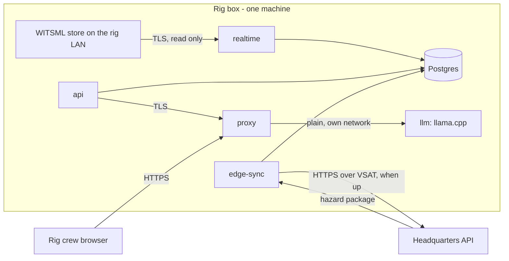

# Rig Edge Pack

One box on the rig that keeps working with no link to headquarters: the web app, the API, the
real-time service with its detectors, the hazard package for the well being drilled, and a small
local LLM for chat and alert explanations. When the VSAT link is up, a sync agent sends the rig's
records to headquarters and fetches a fresh package. Code: `apps/api/src/api/edge.py`;
compose profile `edge`.



## What runs

| Service | Role |
|---|---|
| postgres, s3, keycloak, api, web, proxy | The same as at headquarters: users sign in locally (same realm export) |
| realtime | Polls the rig's WITSML store (`RT_WITSML_URL`), runs the detectors from the package, raises alerts |
| llm | llama.cpp serving a small GGUF model (OpenAI-compatible); the proxy serves it to the backend over TLS at `https://proxy:8081` |
| edge-sync | `python -m api.edge agent`: uploads and refreshes when headquarters answers |
| prometheus, grafana | Local service levels (feed latency and alert evaluation on the rig) |

Not on the rig: Dagster ingestion, Tempo, Loki. `.env` on the box:

```dotenv
COMPOSE_PROFILES=edge
EDGE_ID=rig-07
HQ_URL=https://hq.example.com/api
HQ_TOKEN_URL=https://hq.example.com/auth/realms/wells/protocol/openid-connect/token
EDGE_SYNC_CLIENT_ID=edge-sync-rig-07
EDGE_SYNC_CLIENT_SECRET=<that client's secret in headquarters' Keycloak>
RT_WELLBORE_ID=19
RT_WITSML_URL=https://10.20.0.15/witsml/store
RT_DETECTORS=/models/realtime/detectors.joblib
LLM_BACKEND=vllm
LLM_URL=https://proxy:8081
LLM_MODEL=qwen2.5-1.5b-instruct
EDGE_LLM_MODEL_FILE=qwen2.5-1.5b-instruct-q4_k_m.gguf
EMBED_BACKEND=hash
OTEL_EXPORTER_OTLP_ENDPOINT=
```

Delete `COMPOSE_FILE` (base file only: no egress) and run the firewall script with the WITSML
store and headquarters as the only destinations ([Operations](index.md#deployment-shapes)). The
box must trust headquarters' CA (and the WITSML store's, if it uses TLS): put the PEM files in
the stack's trust list and rebuild the bundles:

```bash
docker compose run --rm --no-deps -T --entrypoint sh init -c "mkdir -p /ca/trust && cat > /ca/trust/hq.pem" < hq-ca.pem
```

```bash
docker compose run --rm init
```

## The hazard package

A `tar.gz` with a manifest, one CSV per table and, optionally, the files:

- **Rows:** every table the app reads (wells, wellbores, surveys, tops, events, casing, mud,
  LOT/FIT, documents and their source references, passages for the assistant, lessons, offset
  selections, hazard profiles, programs, lint runs, briefings, formations, the knowledge graph),
  **limited by row-level security** to the licence blocks and JVs of the wellbore and of its
  latest offset selection, and, when headquarters builds it for the sync account, to what that
  account may see. Not included: alerts, shelves and the real-time tables (they are made on the
  rig), the review queue, conversations, the audit log.
- **Files** (first load only): every visible document PDF and voice recording, so the evidence
  viewer works offline. Refreshes over VSAT leave files out.
- **Detector bank:** `models/detectors.joblib` and its SHA-256 (the service checks it).
- **Manifest:** created time, wellbore, blocks, JVs, schema revision, SHA-256 of every member.
  Loading refuses a package whose checksums or schema revision do not match.

First load, at mobilisation (USB or a good link):

```bash
make edge-package WELL=19
```

```bash
docker compose exec -T edge-sync python -m api.edge load /dev/stdin --models-dir /models/realtime < hazard-package-19.tar.gz
```

```bash
docker compose restart realtime
```

Loading upserts rows by primary key (rows keep headquarters' ids), stores the files in the
box's object store, records the manifest in `edge_state`, and calls `edge_enable()`: identity sequences
move to 2^50 so rows made on the rig never collide with packaged rows, and outbox triggers
start. Rows deleted at headquarters are not deleted on the rig.

## Sync when the link returns

Every `--interval` seconds (60) the agent checks `HQ_URL/health`. When it answers:

1. Gets a token for the `edge-sync` service account (client credentials; realm role
   `edge_sync` plus the licence blocks it may write).
2. Uploads, in batches of 500: alerts, shelves and voice notes the outbox triggers queued
   (alerts only when something that matters changed: status, tier, cleared, acknowledged,
   feedback, explanation, shelf), voice-note recordings, the feed's state, and the audit
   entries since the last upload. `POST /edge/sync`.
3. Headquarters maps each rig id to its own (`edge_record`), so a batch sent twice updates
   instead of duplicating; checks the rig's audit chain continues from the last entry it
   received and recomputes every entry's hash (an edited or missing rig entry: 409, nothing
   applied); stores the rig's entries inside its own chain (`edge.sync` audit entry); and
   answers with the new head.
4. The rig clears the outbox rows the batch covered and moves its audit watermark. A failure
   at any point leaves both as they were: the next attempt sends the same rows again.
5. Every 6 hours (`--package-every`), fetches a fresh package without files
   (`GET /edge/package/{wellbore}`) and loads it, detector bank included; the real-time service
   picks up a new bank at its next restart (`docker compose restart realtime` at a quiet
   moment).

Full-rate time series stays on the rig: the rig's WITSML store already replicates to the
operator's real-time centre, and VSAT has better uses. Headquarters' fleet board shows the
rig's feed state from the last sync.

## When the link is down

Nothing on the rig waits for it: alerts, acknowledgements, shelves, voice notes, chat and the
roadmap all work locally. The outbox grows (a few hundred rows a day). The fleet board at
headquarters shows the rig's last known state with its age. When the link returns the backlog
goes up in order, 20 batches per cycle.

## The local model

llama.cpp loads a GGUF file from the `models` volume (`models/llm/<EDGE_LLM_MODEL_FILE>`). The
file is side-loaded: nothing downloads at run time. Copy it in once:

```bash
docker compose run --rm --no-deps -T --entrypoint sh init -c "mkdir -p /models/llm && cat > /models/llm/qwen2.5-1.5b-instruct-q4_k_m.gguf" < qwen2.5-1.5b-instruct-q4_k_m.gguf
```

Then `docker compose up -d llm`. A 1.5B model at Q4 needs about 1.5 GB of RAM and answers in
seconds on a rig server CPU. It drafts; the same verifier as at headquarters checks every
number against the cited evidence, so a weaker model gives more "not in the records" answers,
not wrong ones. Model licences: [Licences](../licences.md#models).

Embeddings on the rig use `EMBED_BACKEND=hash` (no model needed; weaker retrieval than bge-m3).

## Security of the box

- Same TLS and network rules as headquarters; the firewall allows only the WITSML store and
  headquarters.
- The sync account can only write rows its licence blocks allow (row-level security applies to
  `POST /edge/sync`), and only through `/edge/*`.
- `EDGE_SYNC_CLIENT_SECRET` is the box's credential: rotate it in Keycloak and on the box
  together. A stolen box can upload records for its blocks until then; it cannot read other
  blocks.
- Production: one Keycloak client per box, named `edge-sync-<EDGE_ID>` (a copy of `edge-sync`
  with its own secret, role `edge_sync` and only that rig's blocks). Headquarters then accepts
  batches from that account only for that box (403 otherwise), and one box can be cut off
  without touching the others. The single shared `edge-sync` client in the realm export is for
  development.
- The box's audit chain is checked at headquarters on every sync, so edits on a box that is
  later reconnected are detected.
