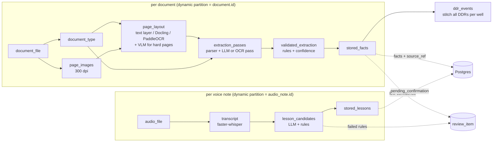

# Pipelines

Dagster code lives in `pipelines/src/pipelines`; the code location is `defs` in
`pipelines/__init__.py`. The UI runs at <http://localhost:3001>. Everything that decides
anything (parsing, units, rules, confidence) is plain Python and runs without Dagster, which is
how the tests and the evaluation run it.

## Asset graph



| Asset | Does | Output |
|---|---|---|
| `document_file` | Reads the `document` row, fetches the file from the S3 object store to the work dir | path + metadata |
| `document_type` | First classification from the text layer, file name and registered type | type, confidence |
| `page_images` | Renders every page at 300 dpi (grayscale PNG, cached) | image paths |
| `page_layout` | Per page: PDF text layer if present; else deskew, then Docling, then PaddleOCR; VLM when a page is hard | cells with bbox + confidence |
| `extraction_passes` | Re-classifies from the layout, runs pass A (template parser) and pass B (LLM with guided JSON, or parser on a PaddleOCR re-read) | two `Extraction`s |
| `validated_extraction` | Rules, confidence, accept / review; writes `results/<id>.json` | `DocResult` |
| `stored_facts` | Accepted facts with `source_ref` (page + bbox); everything else to `review_item` | counts |
| `ddr_events` | Stitches the accepted time-breakdown rows of every processed DDR, per well | `event` rows with `timeline` |
| `audio_file` → `transcript` → `lesson_candidates` → `stored_lessons` | Voice-note flow below | lessons, review items |

Sensors `new_documents` and `new_audio_notes` add a partition for every registered row
(`make seed` registers them) and request `document_job` / `voice_job`. `ddr_events_job` runs
hourly. Resources: `db` (Postgres, table owner), `storage` (S3 object store + work dir), `models`
(LLM/VLM/ASR and thresholds), all from environment variables (see `.env.example`).

## Document flow

1. **Classify.** Weighted keywords on the first two pages ("well completion report", "time
   breakdown", "directional survey", …) plus file-name hints and the registered type. Without
   readable text the file name and registered type decide at confidence ≤ 0.5; the type is
   re-checked after OCR.
2. **Render** every page at 300 dpi.
3. **Layout.** A *cell* is one value, label or table cell, with a page-relative bbox and a
   recognition confidence.
    - Born-digital pages: the PDF text layer (pdfium), confidence 1.0. Rotated glyphs (the
      SYNTHETIC watermark, stamps) and our own SYNTHETIC marking are dropped.
    - Image-only pages: **deskew** first (projection-profile search over ±4°), then **Docling**
      (layout + table structure + its OCR); cells get `DOCLING_CONF` (0.9) because Docling
      exposes no per-item confidence. If Docling reads nothing, **PaddleOCR** (mobile detector,
      per-line confidence).
    - **PaddleOCR fallback on weak layouts:** if the document's main table (WCR tops, DDR time
      breakdown, survey stations) is not found in Docling's layout, the Docling pages are re-read
      with PaddleOCR and the better parse (more readable values, fewer unreadable ones) is kept.
    - **Hard pages → VLM:** no cells, mean OCR confidence < 0.80, or a handwritten field note.
      The VLM (`VLM_MODEL`) transcribes the page line by line with approximate boxes on a
      0–1000 grid (`transcribe_page@v2`); its cells get `vlm_conf` 0.85.
    - Boxes found on deskewed images are rotated back onto the original page before storage.
4. **Extract, twice.** Values are captured *as printed* into the Pydantic model of the
   document type (`schemas.py`), then converted by `norm.canon` (metres, sg, ISO dates, enum
   names). Pass A is the template parser (`extract.py`): labels ("Spud date", "Depth @ 24:00")
   and table headers ("Formation | MD | TVD"), not coordinates, so it runs on any engine's cells.
   Pass B is the LLM (`extract_<type>@v2`, guided JSON from the same Pydantic model; returned
   strings are grounded back to cells for page + bbox) or, with `SECOND_PASS=ocr`, the parser on
   a PaddleOCR re-read.
5. **Rules** (table below) give each field a rule score.
6. **Confidence** (formula below). At or above the threshold: accepted. Below: review queue.
7. **Store.** Accepted values become facts with a `source_ref` (document, page, union bbox of
   the row's fields, extractor version, confidence). A table row is stored only when every field
   it needs is accepted and it can be attached (known well, known formation); otherwise the row
   goes to review as one item next to the per-field items that explain why. A well is created
   only from a WCR whose name, coordinates, datum and elevation are all accepted; Kalianpur 1975
   coordinates are converted to WGS 84 with the pinned EPSG operation (`core.canonical.crs`),
   stored with datum confidence and uncertainty radius; the wellbore gets its own depth datum.
   Formation names are resolved through the ontology (`core.canonical.ontology`: synonyms,
   abbreviations, edit distance, depth plausibility) and every decision is written to
   `name_match`; an unconfirmed name sends its row to review. Documented intervals are recorded
   in `event_documentation` (a WCR's drilling-problems section covers the whole well, even when
   it says there were none; a DDR covers the depth drilled that day), which is how the hazard
   roadmap tells "none" from "unknown". Unit conversions applied to a
   row's values are stored in `source_ref.conversions`. Reruns with the same extractor version
   store nothing twice.

### Confidence formula

```
confidence(field) = min(ocr, consistency, rules)

ocr          recognition confidence of the cell(s) the value was read from
             text layer 1.0 · Docling 0.9 · PaddleOCR per line · VLM 0.85 · ungrounded LLM value 0
consistency  1.0  pass A and pass B agree (within printed precision: 0.16 m, 1e-5°, 0.006)
             0.0  they disagree
             0.5  only one pass produced the value (no second pass configured, or one pass missed it)
rules        1.0 no rule failed · 0.5 only soft rules failed · 0.0 a hard rule failed

accepted  ⇔  confidence ≥ CONFIDENCE_THRESHOLD (0.8) and the printed text was readable
```

Consequence, by design: **with no second pass configured nothing is auto-accepted**, and every
value waits for a reviewer. Set `LLM_BACKEND` (or `SECOND_PASS=ocr`) to let agreeing values
through.

### Validation rules

| Rule | Severity | Checks |
|---|---|---|
| `R-PARSE` | hard | The printed text could be read as the field's type (number with unit, date, DMS, enum) |
| `R-RANGE` | hard | Units and ranges: depths 0–8000 m, N/E ±8000 m, MW/ECD 0.8–2.6 sg, EMW 0.8–2.8 sg, inc 0–180°, azi 0–360°, row hours 0–24, lat/lon valid, weight 5–200 lb/ft |
| `R-MONOTONIC` | hard | Formation top MD strictly increasing; survey MD strictly increasing and TVD non-decreasing; casing shoes deeper in listed order |
| `R-TVD-LE-MD` | hard | TVD ≤ MD (+0.5 m) for tops and survey stations |
| `R-CASING-STD` | hard | Casing OD in the API 5CT list (4-1/2 … 30 in), also for LOT/FIT "below shoe" |
| `R-CASING-ORDER` | hard | Each string smaller than the one before |
| `R-HOLE-GT-OD` | hard | Hole size larger than the casing run in it |
| `R-HOLE-STD` | soft | Hole size is a common bit size |
| `R-GRADE` | soft | Casing grade is a known API grade (H40 … Q125) |
| `R-DDR-24H` | hard | Time-breakdown hours sum to 24; printed total is 24 |
| `R-DDR-ROW` | hard | Each row's to − from equals its hours |
| `R-DDR-GAP` | hard | Each row starts where the previous ended |
| `R-DDR-NPT` | soft | "NPT today" equals the sum of NPT-coded rows |
| `R-DEPTH-LE-TD` | hard | Every MD (tops, shoes, events, DDR depth) ≤ TD (+1 m) |
| `R-DATES` | hard / soft | Spud ≤ completion (hard); events inside spud..completion (soft); dates 1900..today (hard) |
| `R-DATUM` | hard | Coordinates come with a stated datum |
| `R-REQUIRED` | hard | Well name (and TD for a WCR, report date for a DDR, event type for a field note) present |
| `R-CLASSIFY` | hard | Document type recognised |

### DDR specifics

- **Time breakdown** rows are parsed as a table (from, to, hours, code, operation).
- **IADC-style codes** come from the operation *text* (`ddr.ACTIVITY_RULES`: drilling 2,
  circulate 5, trips 6, rig repair 8, logging 11, casing & cement 12, WOC 13, BOP 14, fishing 19,
  other 21), with an NPT category for losses, stuck pipe, kicks and rig repair. Printed
  mnemonics are used only to check the mapping (see [Evaluation](evaluation.md)).
- **Stitching:** consecutive NPT rows of one category that touch in time, including across
  midnight into the next day's report, become one `event` with `t_start`, `t_end`, summed
  `npt_hr`, depth from the text, and a `timeline` of every row (date, from, to, hours, text,
  document, page, bbox). Provenance is the first row; confidence the lowest of its rows. Only
  accepted rows are stitched.

## Voice notes

1. **ASR:** faster-whisper (`WHISPER_MODEL`, default `small`, int8 on CPU), word timestamps,
   VAD, temperature 0. Language is auto-detected but restricted to **Hindi, Assamese, English**:
   another best guess is overridden by the most likely of the three and noted.
2. **Lessons:** the LLM (`extract_lessons@v2`, guided JSON, `LessonsOut` model) returns
   `{formation, hazard, depth_top, depth_base, depth_unit, what_happened, what_worked,
   evidence}`, with the known formation names in the prompt.
3. **Rules:** schema (Pydantic), formation must match `formation.name` or a synonym, hazard in
   the event-type list, depth has a unit and lies in 0–8000 m with top ≤ base, `what_happened`
   not empty, and the `evidence` quote must be found in the transcript (fuzzy match ≥ 0.6).
4. **Provenance:** the quote is located in the word stream; its first and last word timestamps
   become `source_ref.t_start` / `t_end` on the audio note. Confidence = min(lowest ASR word
   probability in the quote, rule score).
5. **Store:** valid lessons → `lesson` with **status `pending_confirmation`**, author
   `pipeline:<version>`, `md_top` / `md_base` in metres; failing ones → `review_item`
   (kind `lesson`).

## LLM calls

- **Prompts** are files: `pipelines/src/pipelines/prompts/<name>/<version>.md`, pinned in
  `llm.PROMPT_VERSIONS`. A change is a new file (`v2.md`) and a new pin; old versions stay so
  logged calls stay explainable. Templates use `$variables`.
- **Backends:** `LLM_BACKEND=ollama` (native `/api/chat`, `format` = JSON schema) or `vllm`
  (OpenAI-compatible `/v1/chat/completions`, `response_format: json_schema`, which vLLM
  enforces with guided decoding). `LLM_URL`, `LLM_MODEL`, `VLM_MODEL` choose the server and
  models.
- **Temperature 0** (and seed 0) for every extraction call.
- **Logging:** every attempt is written to `llm_call` (or `llm_calls.jsonl` without a database):
  backend, model, model version (Ollama digest from `/api/tags`; vLLM model id + system
  fingerprint), prompt id and sha256, `input_hash` = sha256 of backend, model, prompt id,
  rendered prompt, schema and image hashes, request, raw output, parse result, error, latency,
  document or audio note.
- **Retries:** if the output is not JSON or fails Pydantic validation, the call is repeated (up
  to 3 attempts) with a **stricter schema** (every property required, no extra keys) and the
  validation error appended to the prompt. After the last failure the pass returns nothing and
  its fields fall back to single-pass consistency.
- **Untrusted text:** document text and transcripts may contain instructions; every prompt
  (`v2`) says they are data, and nothing the model returns is accepted without the validation
  rules and the second pass ([Security → Prompt injection](security.md#prompt-injection-via-documents)).
- **Traces and metrics:** every asset step is a span (`ingest.<asset>`); all steps of one
  document's run share a trace, with each LLM attempt as an `llm.call` child.
  `wells_llm_seconds` times every attempt by prompt, model and outcome
  ([Operations → Observability](operations/index.md#observability)).

## Configuration

| Variable | Default | Meaning |
|---|---|---|
| `LLM_BACKEND` | `none` | `ollama`, `vllm` or `none` |
| `LLM_URL` | `http://ollama:11434` | Server base URL |
| `LLM_MODEL` / `VLM_MODEL` | `qwen2.5:7b-instruct` / `qwen2.5vl:7b` | Text and vision models |
| `WHISPER_MODEL` | `small` | faster-whisper model size |
| `CONFIDENCE_THRESHOLD` | `0.8` | Acceptance threshold |
| `SECOND_PASS` | `auto` | `auto` (LLM if configured), `llm`, `ocr`, `none` |
| `LAYOUT_ENGINES` | `text_layer,docling,paddleocr` | Engine order |
| `DOCLING_CONF` | `0.9` | Confidence given to Docling OCR text |
| `PADDLE_DET`, `PADDLE_MAX_SIDE`, `PADDLE_MKLDNN` | mobile det, 2000, off | PaddleOCR speed/compatibility |

Docling, PaddleOCR and faster-whisper are optional extras (`uv sync --extra ocr --extra speech`);
they download their models on first use. The `dagster` image installs both extras.

## Adding a document type

1. **Schema:** add a Pydantic model of the values *as printed* to `schemas.py` and register it in
   `SCHEMAS`. List rows become `name[i].field`.
2. **Canonical values:** if a field needs new interpretation (a unit, a code list), extend
   `norm.canon` for its leaf name.
3. **Parser:** write `parse_<type>(pages) -> Extraction` in `extract.py` using `kv` (labels) and
   `table` (header synonyms, required columns, row test); register it in `PARSERS`.
4. **Classifier:** add keywords (and a file-name hint) in `classify.py`.
5. **Prompt:** add `prompts/extract_<type>/v1.md` and pin it in `PROMPT_VERSIONS`.
6. **Rules:** add any type-specific rule to `rules.RULES`; required fields in `rules.required`.
7. **Storage:** add `_<type>` to `store.Store` mapping accepted fields to tables, and the row
   requirements in `REQUIRED_ROW`.
8. **Gold + tests:** add examples with field truth to the gold set and a case to
   `pipelines/tests`; rerun `python -m pipelines.evaluate --write-docs`.
