# Screens

Eleven screens, built on the [design system](design-system.md). Every screenshot on this page is
written by Playwright (`tests/e2e/screens.spec.ts`) against **seed data captured from the real
API**, not typed in: `tests/e2e/fixtures/capture.py` runs the API over the synthetic Upper Assam
dataset (30 wells, truth loaded, every well replayed through the live path, three hard documents
run through the real extraction pipeline) and saves each response. The mocked API in
`tests/e2e/mock.ts` serves those files, shifting the replay's 2030 clock to "now" and streaming
the active well (SA-19) sample by sample with the posterior the replay computed. All data is
**synthetic**.

```bash
make evaluation     # synthetic truth + leave-one-well-out replay (the seed data's source)
make ui-fixtures    # capture the API's responses into tests/e2e/fixtures
make screenshots    # write docs/ui/screenshots (PW_CHANNEL=msedge uses an installed Edge)
```

Every data screen has four states besides "ready", tested in `tests/e2e/states.spec.ts`:

| State | What the user sees |
|---|---|
| Loading | Skeleton blocks the size of what is coming (`data-loading`), never a blank page |
| Error | A red notice that says why (the API's message) and a **Retry** button |
| Empty | An empty state that says what is missing and how to get it |
| Stale | Network gone: the last data this device fetched, under a gold banner with the time it was saved. The live console turns grey and reads **DATA STALE** instead |

## 1. Offset map

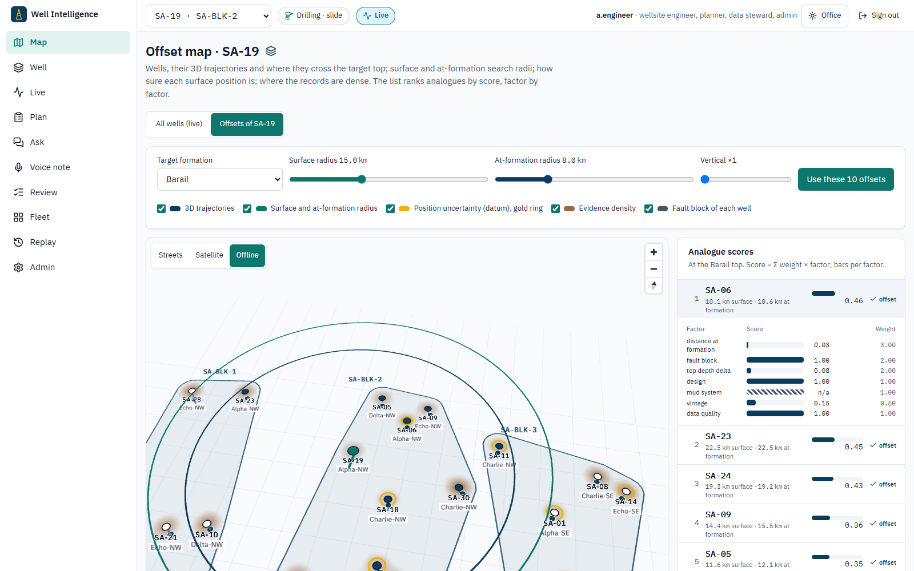

**Route** `#/map` (the selected well). **For** choosing analogue wells.

- **Two views**: **All wells (live)** (the 30 Upper Assam wells and the public Sodir wells, with
  a list of the newest public wells and each one's facts, FactPage and press release; refreshed
  every 5 minutes) and **Offsets of <well>** (the analogue ranking below).
- **3D earth** (All wells view): MapLibre globe projection with terrain relief from the open AWS
  Terrain Tiles (Mapzen: SRTM, GMTED), hillshade, sky and atmosphere. It opens on the whole globe
  and flies down to the wells; labels are MapLibre symbols draped on the terrain. The offset view
  stays a flat projection so 3D trajectories can run below ground. Offline: a flat map.
- **Map** (MapLibre camera and controls, deck.gl layers). Basemap switch: **Streets**
  (OpenFreeMap / OpenStreetMap vector tiles), **Satellite** (Esri World Imagery), **Offline** (a
  plain background and a graticule; no tiles). The choice is remembered per browser; with no
  internet the map falls back to Offline by itself. Only the browser fetches tiles: no backend
  service has a route out. `VITE_BASEMAP_STYLE` replaces Streets with a self-hosted MapLibre
  style (company network). **Zoom to** jumps between Upper Assam, the Norwegian shelf and both.
- **Public wells**: petrol = oil or gas found, grey = dry or unknown, gold and labelled = new
  (first seen in, or spudded within, the last 30 days). Hover for a summary, click for details.
- **Wells** as markers (teal = this well, petrol = selected offsets, white = others), labelled,
  with their **fault block** under the name.
- **3D trajectories** from the surveys, and where each crosses the target top (dots at depth).
  Vertical exaggeration 1–6×; tilt, rotate and zoom with the mouse, touch or keyboard.
- **Dual radius**: surface radius around the well head (teal) and at-formation radius around
  where this well crosses the target top (petrol, drawn at that depth).
- **Datum-uncertainty halos**: a gold ring around wells whose printed coordinates were in another
  datum (Kalianpur 1975: ±22 m after transformation; an *inferred* datum gives hundreds of
  metres).
- **Evidence-density heat** (sepia): number of records (tops, events, casing, mud, LOT/FIT) per
  well.
- **Side panel**: analogues by score; open one for its per-factor bars (score 0–1, weight;
  hatched = unknown, scored neutral). **Use these N offsets** stores the selection.

API: `GET /offsets/preview/{id}`, `POST /offsets/select`. Tests: `flows.spec.ts` "offset map".

## 2. Correlation panel

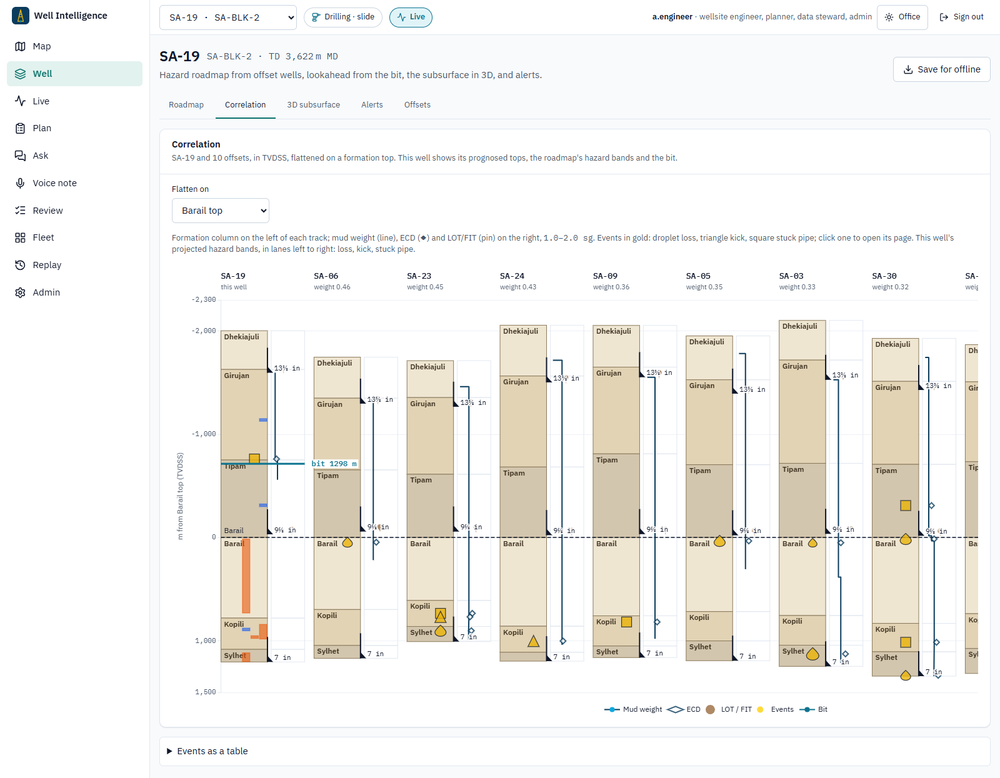

**Route** `#/well/{id}/correlation`. **For** seeing where offsets had trouble, relative to the
formation the plan cares about.

- One depth track per well (this well first, then offsets by weight), **flattened on a formation
  top** (default: the selection's target formation), in TVDSS.
- Formation bands in earth tones; casing shoes (black triangle and size); **events** in gold —
  droplet = loss, triangle = kick, square = stuck pipe — with a tooltip (depth, formation, MW/ECD,
  volume, NPT, narrative, source). Click one to open its page in the evidence viewer.
- Right half of each track: mud weight (line), ECD (◆) and LOT/FIT (pin) on 1.0–2.0 sg.
- This well: prognosed tops, the roadmap's **projected hazard bands** in lanes by hazard (colour =
  risk tier), and the **bit**.
- Below: the same events as a table (the accessible alternative), each with its evidence chip.

API: `GET /correlation/{id}?datum=`. Tests: `flows.spec.ts` "correlation".

## 3. Hazard roadmap and lookahead

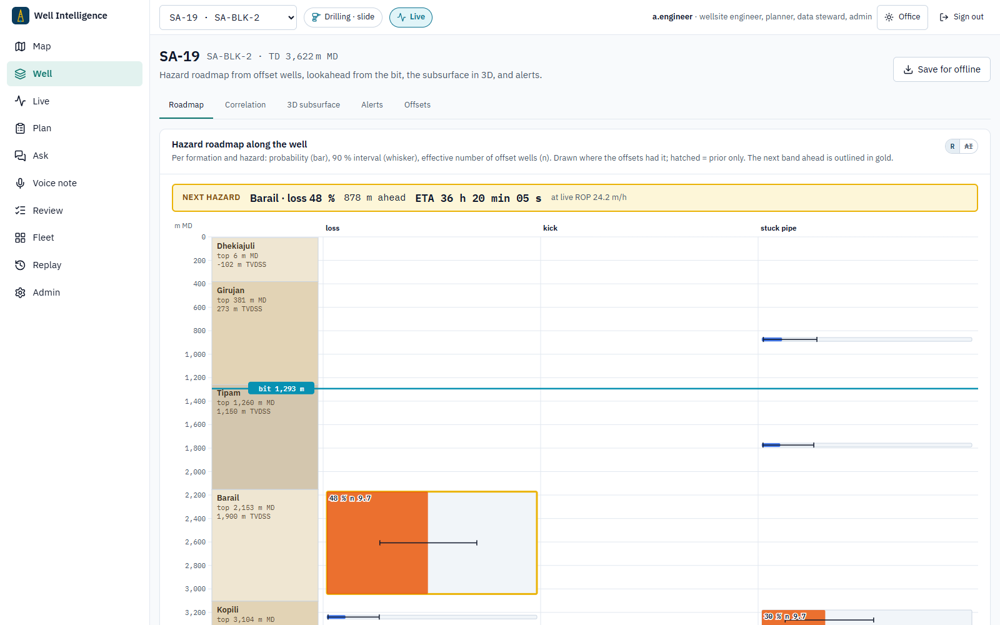

**Route** `#/well/{id}`. **For** what is ahead of the bit.

- A vertical strip in measured depth: formations, then one column per hazard. Each cell: a bar
  for the probability (tier colour), a whisker for the 90 % interval, `n` = effective number of
  offset wells; drawn over the depth band where offsets had it; hatched = prior only.
- The bit (cyan). The **next hazard** band ahead is outlined in gold, with distance and an **ETA
  countdown** at the live ROP (smoothed), else the rolling rate from the last 12 h.
- Below: the full matrix and the lookahead table.

API: `GET /active/{id}/hazard-profile`, `/lookahead`, the live stream. Tests: `flows.spec.ts`
"hazard roadmap".

## 4. Live console (Rig mode)

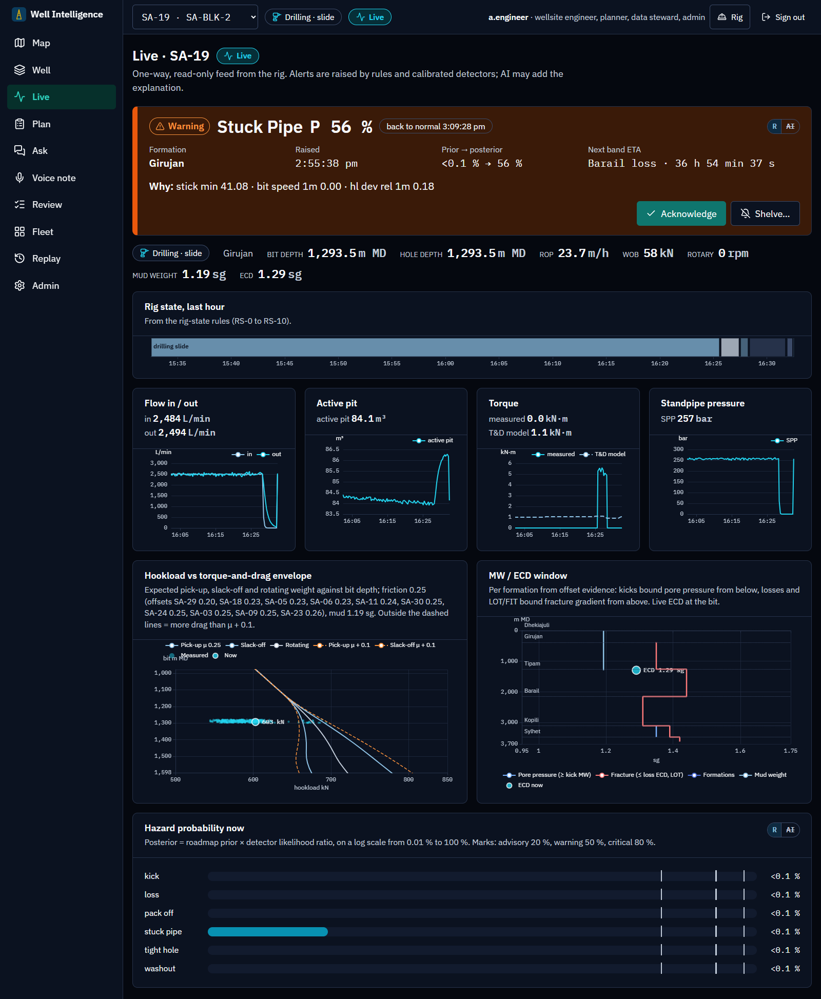

**Route** `#/live/{id}`. **For** the driller's cabin and the company man's office.

- **Alert card**: tier colour and word, hazard, posterior P, formation, time raised, prior →
  posterior, the next band's ETA, the **why** (the AI explanation when there is one, else the
  rule features that fired), evidence chips; **Acknowledge** and **Shelve…** (minutes and a
  required reason; critical alerts are never shelved).
- Channel readouts with units; **rig-state timeline** for the last hour.
- **Live charts**, last 30 min: flow in/out, active pit, torque (with the torque-and-drag model
  dashed), standpipe pressure.
- **Hookload vs T&D envelope**: expected pick-up, slack-off and rotating weight against bit depth
  at the calibrated friction factor (dashed: μ + 0.1), with measured hookload while moving.
- **MW/ECD window**: per formation, pore pressure bounded from below by offset kicks and fracture
  gradient bounded from above by losses and LOT/FIT; mud weight and live ECD at the bit.
- Hazard probability now (log scale with the alarm thresholds).

Stale feed: everything greys out and the banner reads DATA STALE:

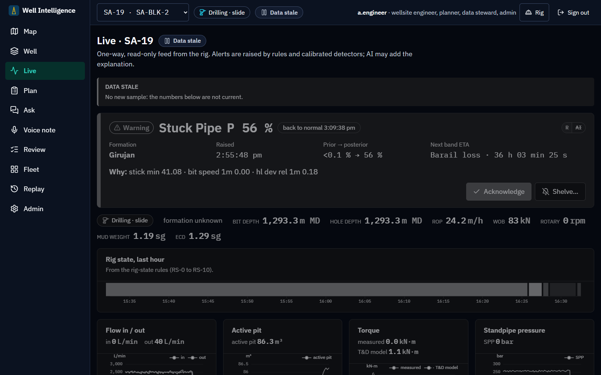

API: `WS /active/{id}/stream`, `GET /active/{id}/history`, `/envelope`, `/lookahead`,
`POST /alerts/{id}/ack`, `POST /active/{id}/shelves`. Tests: `flows.spec.ts` "live console",
`live-stale.spec.ts`, `states.spec.ts`.

## 5. Evidence viewer

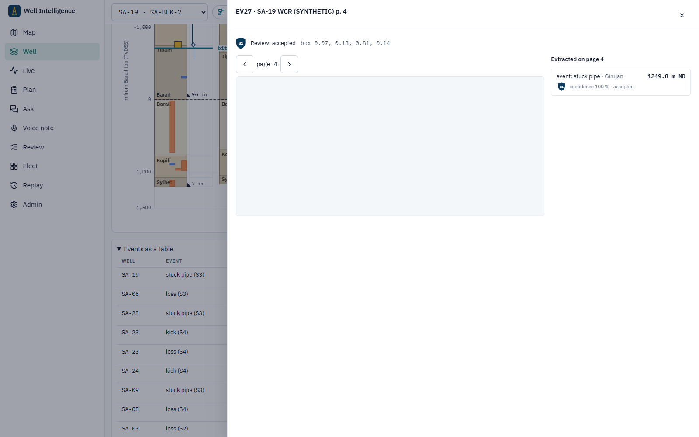

Opens from any evidence chip. **For** checking a number against its source.

- The PDF page rendered by PDF.js at the screen's pixel density, the cited value boxed in gold,
  other values extracted from the page outlined; page through the document.
- Beside it: every value stored from that page (field, value with unit, confidence, review
  status, evidence grade); click one to box it. Values held for review on that page are listed
  too.
- A voice-note citation opens an **audio player at the cited second**, a "play cited span"
  button that stops at its end, a timeline with the span in gold and the transcript.
- Citations that only name a source (alerts, roadmap evidence) are resolved first.

API: `GET /documents/{id}/file`, `/fields`, `GET /audio-notes/{id}[/file]`,
`GET /source-refs/{id}`. Tests: `flows.spec.ts` "evidence viewer", "correlation".

## 6. Ask WellMind

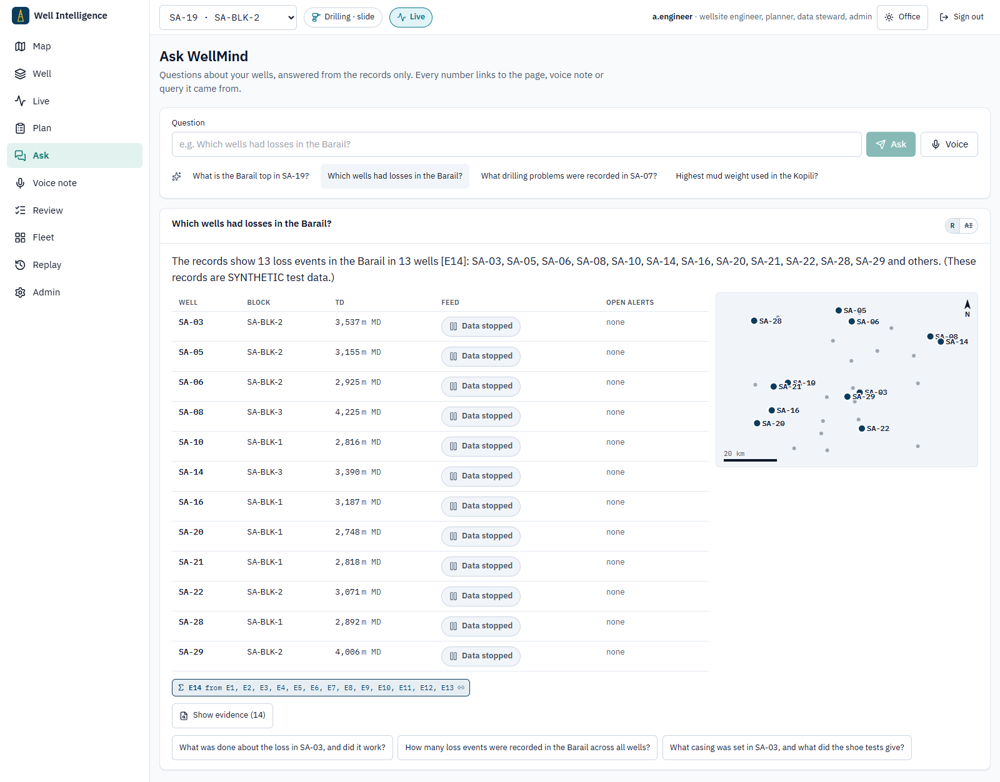

**Route** `#/ask`. **For** questions about the records.

- Answers **stream** in, but only after every number has been checked against the evidence.
- Citation chips under the answer; **Show evidence** opens a drawer with every record and the
  query behind it.
- When the answer names several wells, they appear as a **table and a map**.
- Voice input (Whisper on the server), suggested questions, follow-ups; refusals are shown as
  such (**R | AI** says whether the model or the rules wrote the text).

API: `POST /assistant/ask/stream`, `/assistant/ask/voice`. Tests: `flows.spec.ts`, `ui.spec.ts`.

## 7. Program linter

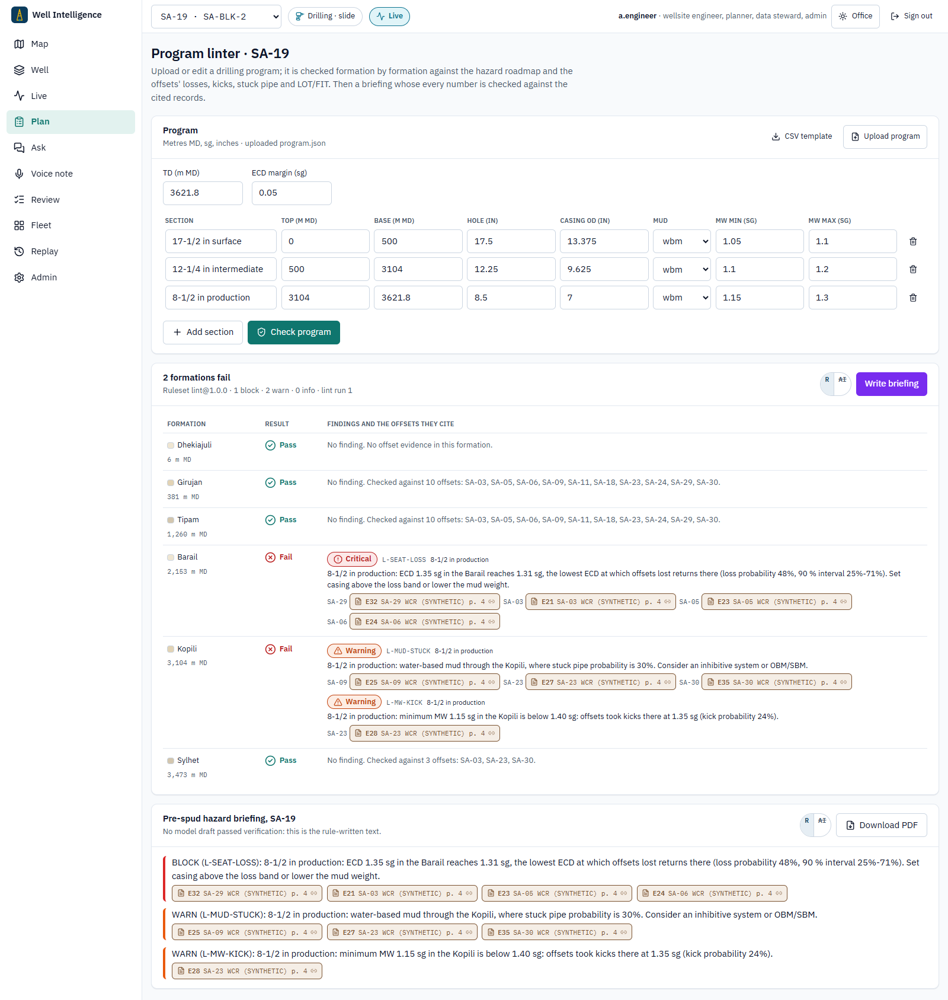

**Route** `#/plan/{id}`. **For** checking a drilling program before spud.

- **Upload** a program (JSON, or CSV with the template's columns; download the template) or edit
  the sections in place. Bad files are refused with the reason (missing column, row and value).
- **Check program**: one row per formation, **Pass** or **Fail**, each finding with its rule,
  severity, the section it concerns and evidence chips naming the offset wells it cites. A pass
  says which offsets it was checked against.
- **Write briefing**: verified LLM text or the rule fallback, every paragraph with its citations;
  **Download PDF**.

API: `POST /programs/lint`, `POST /briefings/{id}`, `GET /briefings/{id}/{n}.pdf`. Tests:
`flows.spec.ts` "program linter" (upload, findings, briefing, PDF; bad CSV).

## 8. Review console

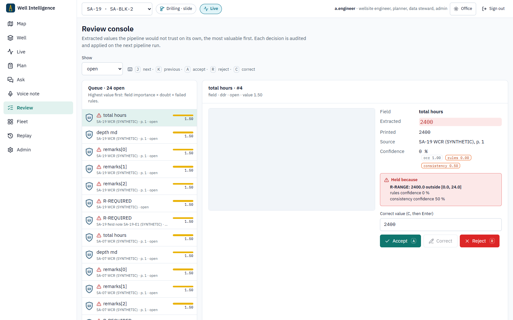

**Route** `#/review`. **For** the data steward.

- Queue **sorted by value** = field importance (depths and pressures 3, events 2.5, casing 2,
  other 1) × (1 − confidence) × (1 + 0.5 per failed rule); the gold bar shows it.
- **Keyboard first**: <kbd>J</kbd> next, <kbd>K</kbd> previous, <kbd>A</kbd> accept,
  <kbd>R</kbd> reject, <kbd>C</kbd> correct (type, Enter). After a decision the next open item is
  selected; the result is announced.
- The page with the value boxed, the extracted fields, the confidence components, and **conflict
  highlights**: failed rules, passes that disagreed, printed text that does not read as the value.

API: `GET /review/items?order=value`, `POST /review/items/{id}`. Tests: `flows.spec.ts` "review
console".

## 9. Fleet board

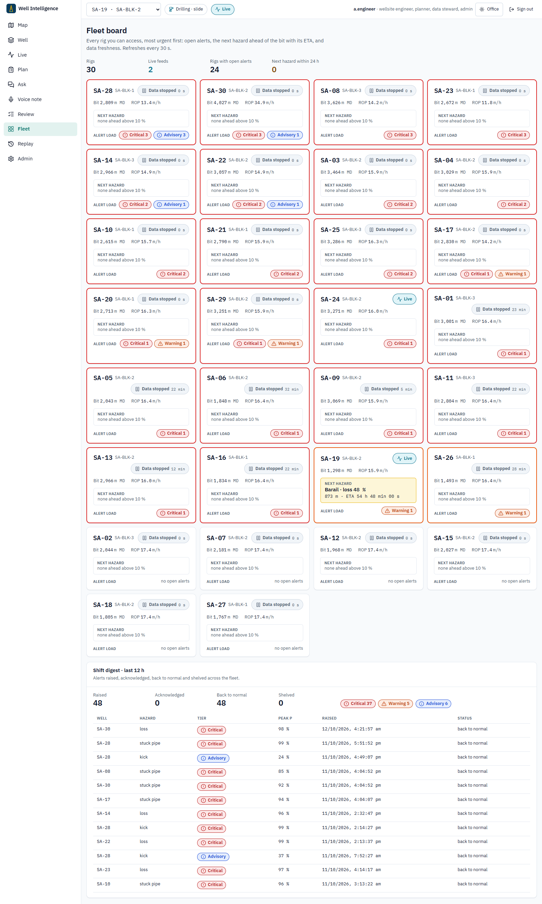

**Route** `#/fleet`. **For** the superintendent.

- One card per rig, most urgent first (open critical, then warning, then advisory alerts, then
  live feeds, then nearest ETA): data freshness with age, bit depth and ROP, the **next hazard**
  with distance and ETA countdown, and the alert load by tier.
- **Shift digest**: alerts raised, acknowledged, back to normal and shelved in the last 12 h, by
  tier, with the list. Refreshes every 30 s.

API: `GET /fleet`. Tests: `flows.spec.ts` "fleet board", `states.spec.ts`.

## 10. Replay studio

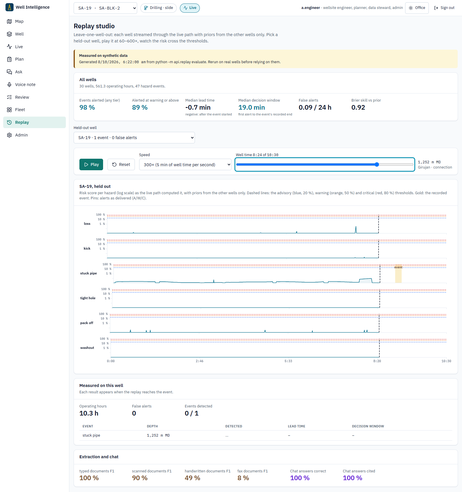

**Route** `#/replay`. **For** trusting (or not) the alarms.

- Pick a held-out well; play it at 60–600× or scrub. One strip per hazard shows the risk score as
  the live path computed it (priors from the other wells only), the advisory / warning / critical
  thresholds, the recorded event in gold and the alerts as delivered.
- **Measured on this well**: events detected and their lead time, false alerts, revealed as the
  replay reaches them. Above: the measured numbers over all wells.

Data: `docs/eval-report/timelines/<well>.json` and `metrics.json`, written by `make evaluation`
and built into the app. Tests: `flows.spec.ts` "replay studio", `ui.spec.ts`.

## 11. Voice note capture

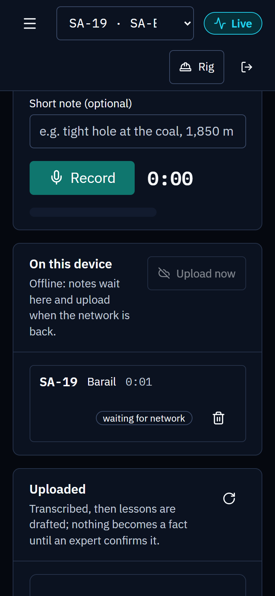 

**Route** `#/voice`, on a phone (installable PWA). **For** the wellsite engineer on the rig floor.

- Pick the well and formation, add a short note, **Record** (big target, level meter), listen,
  **Save**.
- Saved recordings wait **on the device** (IndexedDB) and upload when the network is back; retries
  are safe (each recording has a client id).
- Uploaded notes show their status: transcribing → **pending expert confirmation** (lessons drafted
  from the transcript, nothing is a fact yet) → confirmed or reviewed.

API: `POST /voice-notes`, `GET /voice-notes`. Tests: `flows.spec.ts` "voice note" (recorded
offline, queued, uploaded when back online).

## States

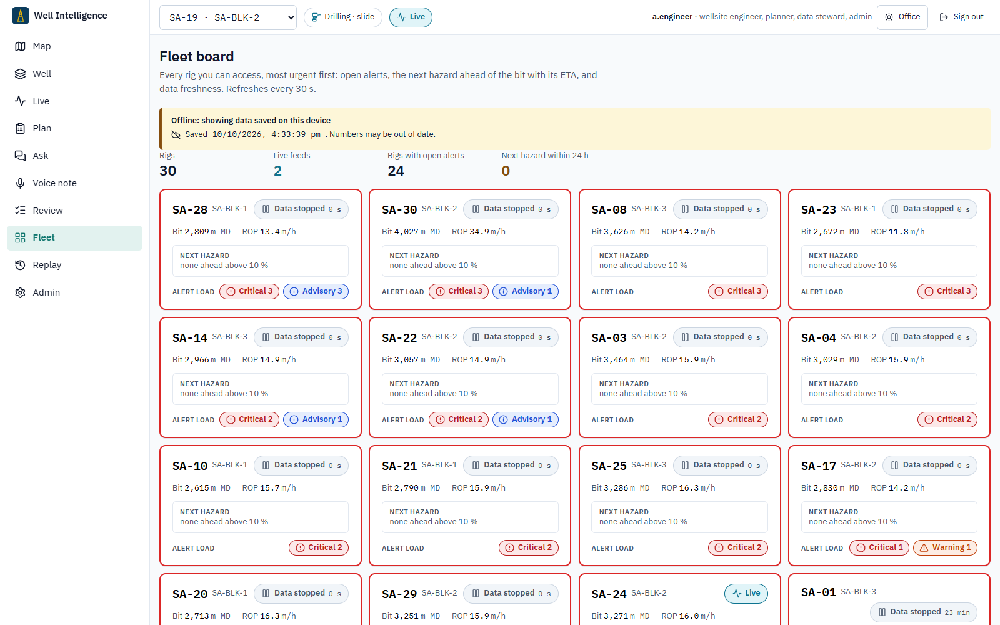

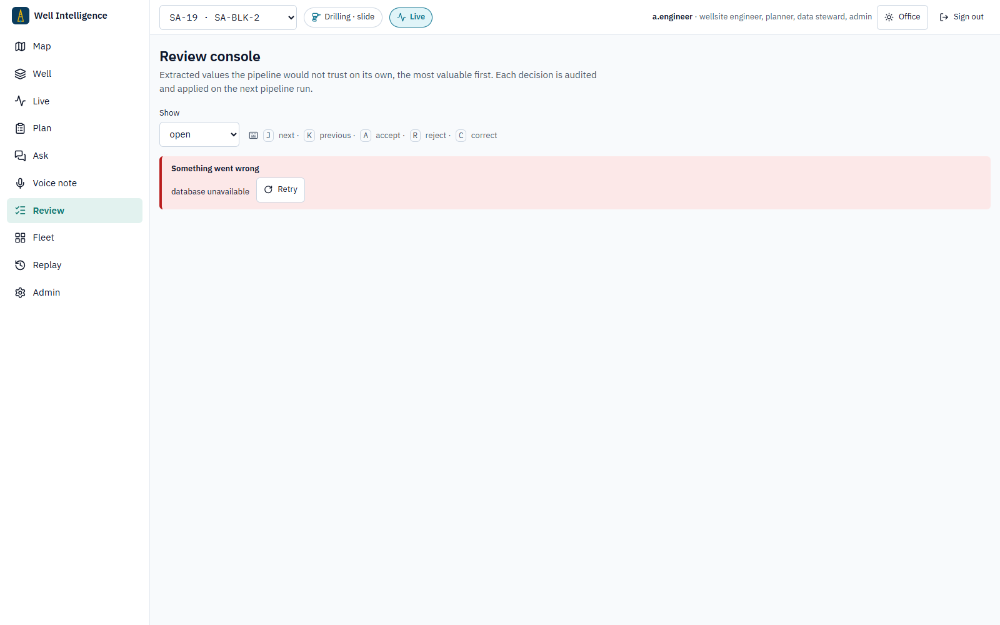

## User guides by role

Each guide matches a Keycloak role ([Security → Identity and roles](../security.md#identity-and-roles)).
Everyone can read every screen within their licence blocks; the app offers each role only its
own actions, and the API refuses the rest. Someone who needs two roles (a planner who also
reviews) gets both from the Keycloak administrator.

### Planner (`planner`; well engineering, before spud)

Plans: selects offsets, checks programs, writes briefings. Cannot acknowledge alerts or decide
review items.

1. **Offset map**: pick the target formation; widen or narrow the surface and at-formation radii
   until the list holds wells that are really like yours. Open the top analogues to see *why*
   they rank (the factor bars); a hatched factor is unknown, not good. **Use these offsets**.
2. **Well → Roadmap**: read the strip top to bottom; a long bar with a short whisker and n ≥ 3 is
   a well-supported risk, a hatched cell is the basin prior only.
3. **Well → Correlation**: flatten on the target top; check where offsets lost returns or took
   kicks relative to it, and at what mud weight. Click an event to read the report page.
4. **Plan**: upload the program (or edit it), **Check program**, fix every **Fail** (each one
   names the offsets it is based on), recheck, then **Write briefing** and download the PDF for
   the pre-spud meeting.
5. Ask WellMind anything the screens do not show; check the cited pages.

### Wellsite engineer (`wellsite_engineer`; on the rig)

Operates: acknowledges, shelves and gives feedback on alerts, records voice notes. Cannot
select offsets or decide review items. On a rig box the same screens work with no link to
headquarters ([Rig Edge Pack](../operations/edge.md)).

1. Switch to **Rig** theme (top bar): dark, large targets, no animation.
2. **Live**: the alert card says what, where, how likely and why; **Acknowledge** what you have
   seen. Shelve only with a reason (pit transfer, planned operation); critical alerts cannot be
   shelved. Grey screen = **DATA STALE**: the numbers are old, check the feed.
3. Watch the hookload against its envelope when tripping and ECD against the window when
   drilling.
4. **Well → Save for offline** before the link drops; the roadmap stays available.
5. **Voice note**: after an event, record what happened; it uploads when there is signal and an
   expert confirms it before anything becomes a fact.

### Superintendent (`superintendent`; fleet, shift handover)

Operates like a wellsite engineer, on every rig in their blocks.

1. **Fleet board**: rigs with critical alerts are on top; the gold box is the next hazard and when
   the bit gets there.
2. A grey card is a rig whose data is stale — call the rig before trusting it.
3. **Shift digest** for the handover: what was raised, acknowledged, shelved.
4. **Replay studio** to judge an alarm: how early it fired on comparable wells and how often it
   fires for nothing.

### Data steward (`data_steward`; records quality)

Reviews: the only role that accepts, corrects or rejects extracted values. Cannot change plans
or alerts.

1. **Review console**, open items, highest value first. Keep your hands on the keyboard:
   <kbd>J</kbd>/<kbd>K</kbd> to move, <kbd>A</kbd> accept, <kbd>R</kbd> reject, <kbd>C</kbd> to
   type the corrected value and Enter.
2. Read the red **Held because** box first: a failed rule or two disagreeing passes means look at
   the page, not just the number.
3. Decisions are audited and applied on the next pipeline run; evidence chips across the app then
   show the value as human-verified (G1).
4. Check confirmed voice-note lessons the same way (they arrive in the queue as items from audio).

### Administrator (`admin`)

Runs the system: the **Admin** page (record counts, detector bank, LLM configuration, feeds,
audit chain status). Sees no well data unless also given licence blocks, and makes no data
decisions. Operating procedures: [Operations](../operations/index.md).
